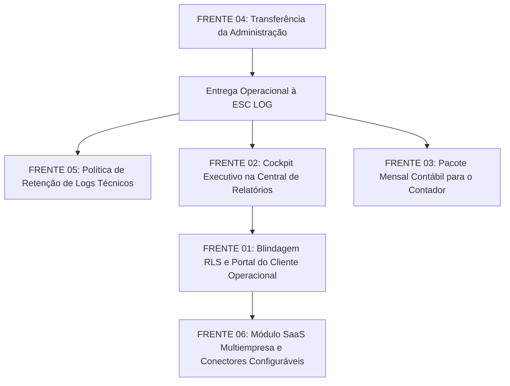

# ERP ORBE — AUDITORIA ESTRATÉGICA FINAL
## INVENTÁRIO TÉCNICO DAS 6 FRENTES DE EVOLUÇÃO

**Projeto:** ERP ORBE — ESC LOG  
**Data da Auditoria:** 03 de Novembro de 2026  
**Ambiente Auditado:** Código-fonte Local + Supabase Cloud (`rest/v1`, RLS, Schema e RPCs) + Aplicação em Produção (`https://orbe-nu.vercel.app`)  
**Modo:** READ-ONLY / INVESTIGAÇÃO ESTRATÉGICA (Sem alteração de dados, sem migrations, sem commits)  

---

## 1. RESUMO EXECUTIVO

O ERP ORBE concluiu com pleno êxito a homologação de seus **12 módulos operacionais, de RH, Financeiro e Governança**, consolidando a baseline de produção no Gate E2E-01 e os endurecimentos de segurança multi-tenant (SEC-02, SEC-02.5 e SEC-03).

A presente auditoria teve como escopo analisar minuciosamente o estado de **6 frentes de evolução** que preparam o ORBE para duas etapas futuras distintas:
1. **Entrega Definitiva à ESC LOG** (operação corporativa plena no dia a dia da empresa).
2. **Evolução para Comercialização SaaS** (oferta da plataforma como produto para terceiros).

### Resumo das Descobertas:
- **Pronto e Estável para a ESC LOG:** Os fluxos vitais do negócio — Lançamentos do Encarregado, Operações por Volume, Serviços Extras, Custos Extras, Fechamento de Diaristas, Apuração CLT/Banco de Horas, Pipeline Financeiro (Receitas e Despesas), Geração e Retorno de CNAB, Controle de Acessos RBAC e Central de Relatórios Oficiais — encontram-se operacionais e homologados.
- **Frentes de Interface vs. Backend:** As frentes de **Portal do Cliente** e **Integração com Contabilidade** existem majoritariamente como componentes visuais na interface, mas contam com lógica de backend simulada ou desacoplada das operações em tempo real.
- **Governança e Administração:** O sistema de governança (SEC-03) possui infraestrutura completa de emissão de convites com OTP (One-Time Password) de 6 dígitos, permitindo uma transferência segura e auditável da administração para o proprietário da ESC LOG sem qualquer risco de perda de dados.
- **Armazenamento de Ponto:** Os registros de ponto (~4.443 linhas, ~5,5 MB) e histórico de importações (~6.508 linhas, ~5,6 MB) ocupam um volume irrisório no banco de dados (menos de 30 MB somando índices), afastando qualquer risco de estouro de quota nos próximos 3 a 5 anos e dispensando expurgos precipitados que violariam a legislação trabalhista (Art. 11 da CLT).
- **Multiempresa (SaaS):** O isolamento de banco de dados (`current_tenant_id()`) e RLS está blindado e pronto a nível de PostgreSQL, mas a plataforma ainda não possui painel de autoatendimento para criação de novos tenants nem área de parametrização visual de conectores de integração (Tio Digital, RHID, n8n).

---

## 2. MATRIZ DAS SEIS FRENTES

| # | Frente de Evolução | Classificação Técnica | Estado no Código | Estado no Banco | Prontidão ESC LOG | Prontidão SaaS |
|---|-------------------|------------------------|------------------|-----------------|-------------------|----------------|
| **01** | **Portal do Cliente** | **EXISTENTE APENAS COMO INTERFACE** | Telas e layout completos (`/cliente/*`); Service consulta faturas genéricas | Tabelas `clientes` (0) e `faturas` (0) vazias; RLS não segrega cliente a cliente | Não bloqueante (uso interno) | Requer evolução estrutural |
| **02** | **Relatórios & Inteligência** | **IMPLEMENTADO E FUNCIONAL** | Central Oficial V4 (`/relatorios`) ativa com 6 cadernos oficiais e exportação CSV/PDF | Consome dados reais de produção (`operacoes_producao`, `diaristas_lotes`, etc.) | **100% Pronto** | Requer Cockpit Executivo |
| **03** | **Integração Contábil** | **EXISTENTE APENAS COMO INTERFACE** | Telas prontas (`/relatorios/integracao`, mapeamento e logs); gatilho simulado | Tabelas `contabil_*` existem com 0 registros; sem conector real de ERP contábil | Não bloqueante (exportação manual viável) | Requer motor contábil |
| **04** | **Transferência da Administração** | **IMPLEMENTADO E FUNCIONAL** | Módulo de Governança completo (`/governanca/usuarios`); fluxo SEC-03 com token e OTP | RPCs seguras (`admin_create_invitation_with_activation_code`, etc.) operacionais | **100% Pronto** | **100% Pronto** |
| **05** | **Armazenamento Registros Ponto** | **IMPLEMENTADO E FUNCIONAL** | Pipeline de ingestão e conciliação CLT ativo; ~4.443 pontos registrados | 5,5 MB ocupados; 0 buckets no Storage; retenção legal de 5 anos viável | **100% Pronto** | Requer arquivamento futuro |
| **06** | **Multiempresa e SaaS** | **IMPLEMENTADO PARCIALMENTE** | Frontend e guardas prontos para tenant; onboarding wizard presente | RLS blindado por `tenant_id`; 1 tenant ativo; sem conector self-service | **100% Pronto para ESC LOG** | Requer camada comercial |

---

## 3. EVIDÊNCIAS TÉCNICAS DETALHADAS

### FRENTE 01 — PORTAL DO CLIENTE
- **Rotas e Telas Encontradas:**
  - `/cliente/dashboard` (`src/pages/Cliente/ClientDashboard.tsx`)
  - `/cliente/relatorios` (`src/pages/Cliente/ClientReports.tsx`)
  - `/cliente/aprovacoes` (`src/pages/Cliente/ClientApprovals.tsx`)
  - Componente de casca: `src/components/layout/PortalShell.tsx`
  - Guarda de rota: `src/components/Auth/PortalGuard.tsx`
  - Provedor de contexto: `src/contexts/ClientContext.tsx`
- **Mecanismo de Autenticação:**
  - O acesso se dá pela tela comum de `/login`.
  - O `ClientContext` busca `public.clientes` onde `user_id = session.user.id`.
  - Em `src/lib/access-control.ts`, as roles válidas são apenas `"admin" | "rh" | "financeiro" | "encarregado" | "gestor" | "user"`. Não existe uma role canônica de `"cliente"`.
- **Análise de Dados no Banco:**
  - `public.clientes`: **0 registros** cadastrados.
  - `public.faturas`: **0 registros** cadastrados.
  - `public.financeiro_consolidados_cliente`: **1 registro** histórico (`2026-09-01`).
- **Segregação e RLS:**
  - As queries em `src/services/financial.service.ts` (`getClientStats`, `getConsolidados`, `getFaturasPendentes`) executam `.from('faturas').select(...)` **sem passar filtro `.eq('cliente_id', ...)`**.
  - A segurança depende exclusivamente de RLS por `tenant_id` (a ESC LOG). Clientes distintos vinculados ao mesmo tenant teriam vazamento transversal de faturas se registros fossem inseridos.
- **Acompanhamento de Serviços In Loco:**
  - **Inexistente.** O portal não consome a tabela `operacoes_producao`, não exibe descargas em andamento, carretas no pátio, colaboradores alocados ou métricas de produtividade física. Trata exclusivamente de faturas e competências financeiras mensais.

---

### FRENTE 02 — RELATÓRIOS E INTELIGÊNCIA OPERACIONAL
- **Arquitetura Existente:**
  - O ORBE possui duas camadas de relatórios:
    1. **Camada Legada V3:** `src/pages/Relatorios/RelatoriosHub.tsx`, `Agendamentos.tsx`, `LayoutsExportacao.tsx`, que consomem a tabela `relatorios_catalogo` (7 registros criados em 19/04/2026).
    2. **Central Oficial Homologada V4 (CONV-14):** `src/pages/Relatorios/CentralRelatoriosOficial.tsx` e `src/services/adapters/relatoriosOficialAdapter.ts`.
- **Catálogo Oficial Operacional:**
  - R01: Analítico de Operações por Volume (Consome dados reais de `operacoes_producao`).
  - R02: Fechamento de Diaristas (Consome `diaristas_lotes`).
  - R03: Faturamento e Receitas (Consome pipeline financeiro de receitas).
  - R04: Custos Extras Operacionais (Consome `custos_extras`).
  - R05: Consolidado de Banco de Horas (Consome `banco_horas_saldos` e `registros_ponto`).
  - R06: Produtividade Individual (Permanentemente bloqueado com status `"in_preparation"` por diretriz arquitetural).
  - R07: Analítico de Serviços Extras (Consome `servicos_extras`).
- **Filtros e Exportações:**
  - Filtros funcionais: Empresa e Competência (Setembro/2026, Outubro/2026, etc.), Filtro por Fluxo.
  - Exportação: Gerador nativo de CSV parametrizado e impressão/visualizador formatado na tela (`RelatorioVisualizadorOficial.tsx`).
- **O que Falta na Interface:**
  - Não há um painel executivo com cards consolidados agregando indicadores de margem, faturamento bruto total e horas extras na primeira dobra da tela.
  - Não há gráficos dinâmicos de tendência ou distribuição por cliente/unidade.

---

### FRENTE 03 — INTEGRAÇÃO COM A CONTABILIDADE
- **Componentes e Telas:**
  - `/relatorios/integracao` (`src/pages/Relatorios/IntegracaoContabil.tsx`)
  - `/relatorios/mapeamento` (`src/pages/Relatorios/MapeamentoContabil.tsx`)
  - `/relatorios/integracao/logs` (`src/pages/Relatorios/LogsIntegracao.tsx`)
  - Central unificada: `src/pages/CentralRelatoriosIntegracoes.tsx`
- **Estado no Banco de Dados:**
  - `contabil_configuracao`: **0 registros**.
  - `contabil_mapeamento`: **0 registros**.
  - `contabil_logs_integracao`: **0 registros**.
- **Evidência de Simulação:**
  - No arquivo `src/services/accounting.service.ts`, o método `triggerIntegration` contém o código:
    ```typescript
    // Simulação de gatilho de integração
    const { data, error } = await supabase
      .from('contabil_logs_integracao')
      .insert({
        tipo_envio: tipo,
        sistema_destino: sistema,
        status: 'sucesso', // No MVP simulamos sucesso
      })
    ```
  - Na tela `LogsIntegracao.tsx`, os contadores de "Sucessos" (128) e "Falhas" (2) são valores estáticos hardcoded no JSX.
  - Não há geração de arquivos em formato SPED Contábil (ECD/ECF), TXT de partidas dobradas ou integração via API com Domínio Sistemas, Alterdata ou Fortes.

---

### FRENTE 04 — TRANSFERÊNCIA DA ADMINISTRAÇÃO
- **Estado Atual dos Administradores:**
  - Foram identificados 2 perfis com role `admin`:
    1. Usuário E2E de testes (`e2e-test@orbe.local`).
    2. Usuário de desenvolvimento (`Orbita Labs`).
  - Na tabela `tenants`, o registro da empresa possui:
    - `id`: `09ccafb6-2cf2-4c83-ac3d-a2913947693c`
    - `name`: `'Minha Empresa'` (nome temporário a ser renomeado para ESC LOG).
    - `created_by`: `41cab92a-4046-4e0a-8cf4-f3ff8210eeed` (UUID do criador inicial).
- **Mapeamento de Dependências:**
  - Nenhuma regra RLS ou código de produção depende do campo `tenants.created_by`. O controle de privilégios admin é exercido unicamente via `profiles.role = 'admin' AND profiles.tenant_id = tenants.id`.
  - O UUID do usuário de testes não está hardcoded em nenhum arquivo de produção (encontrado unicamente em suítes de testes unitários).
- **Mecanismo de Convite e Ativação SEC-03:**
  - Totalmente funcional no banco e na interface via RPC `admin_create_invitation_with_activation_code`.
  - Suporta convite com perfil "Admin" e gera token de ativação + código de 6 dígitos (OTP).
  - O histórico de auditoria (`audit_log`) armazena `usuario_id`, `usuario_nome` e `perfil_usuario` de forma desnormalizada, preservando a autoria das ações mesmo que o usuário inicial seja inativado.

---

### FRENTE 05 — ARMAZENAMENTO DOS REGISTROS DE PONTO
- **Mapeamento Quantitativo em Produção:**
  - `public.registros_ponto`: **4.443 registros** (período de 07/07/2026 a 02/11/2026).
    - 51 colunas (estrutura desnormalizada com marcações brutas, horários calculados, saldo acumulado e inconsistências).
    - Tamanho médio por linha: ~1.302 bytes.
    - Volume em disco (dados brutos): **~5,52 MB**.
    - Volume estimado com índices: **~15 MB**.
  - `public.historico_importacoes`: **6.508 registros**.
    - Volume em disco: **~5,64 MB** (devido ao campo `logs` do n8n/coletor em JSONB).
  - `public.audit_log`: **1.171 registros**.
    - Volume em disco: **~2,57 MB** (com snapshots `valor_anterior` e `valor_novo`).
  - `public.jornadas_trabalho`: **1 registro** padrão.
  - `public.banco_horas_saldos`: **0 registros** consolidados.
  - `Supabase Storage`: **0 buckets criados**. Nenhum arquivo binário, CSV ou AFD bruto está retido em bucket.
- **Projeção de Crescimento:**
  - Base cadastrada: 105 colaboradores (~80 CLT operacionais).
  - Média mensal: 80 colaboradores × 25 dias úteis = ~2.000 marcações/mês.
  - Crescimento em dados: ~2,6 MB por mês (~31 MB por ano).
  - Em 5 anos: ~150.000 registros, totalizando ~160 MB de dados e ~350 MB com índices.
  - **Conclusão:** O volume é extremamente pequeno para bancos PostgreSQL modernos. O limite gratuito do Supabase é de 500 MB e o plano Pro oferece 8 GB. Não há qualquer risco técnico de estrangulamento de espaço nos próximos 5 anos.
- **Aspectos Legais e Trabalhistas:**
  - O Art. 11 da Consolidação das Leis do Trabalho (CLT) fixa a prescrição dos créditos trabalhistas em 5 anos.
  - A Portaria MTP nº 671/2021 exige a guarda e disponibilidade dos registros de controle de ponto eletrônico para fiscalização.
  - **Regra de Ouro:** Nenhum registro da tabela `registros_ponto` deve ser expurgado antes de 5 anos.

---

### FRENTE 06 — MULTIEMPRESA E COMERCIALIZAÇÃO SaaS
- **Isolamento de Dados (RLS Multi-Tenant):**
  - Implementado com excelência no banco através de `public.current_tenant_id()` e cláusulas `tenant_id = public.current_tenant_id()`.
  - As tabelas mestres (`colaboradores`, `empresas`, `operacoes_producao`, `diaristas_lotes`, `registros_ponto`, `financeiro_consolidados_cliente`, `audit_log`) contam com chaves e índices `tenant_id`.
- **Limitações Atuais para Comercialização:**
  - Existe atualmente apenas **1 tenant** ativo no banco (`Minha Empresa`, criado para a ESC LOG).
  - Não existe tela pública de checkout, cadastro de nova empresa contratante ou auto-provisionamento de tenant.
  - O nome do tenant ainda está como `"Minha Empresa"` em vez de `"ESC LOG"`.
  - As Edge Functions de importação (`importar-pontos-rhid`, `importar-colaboradores-tio`) recebem o `tenant_id` por cabeçalho (`x-tenant-id`) ou payload, mas dependem de fluxos externos no n8n.
- **Conectores Configuráveis:**
  - Não existe tela no ORBE para o usuário cadastrar credenciais de coletores ou APIs externas (Tio Digital, Secullum, RHID, etc.). As chaves de serviço estão configuradas em variáveis de ambiente da nuvem ou em automações do n8n.

---

## 4. FUNCIONALIDADES APROVEITÁVEIS

1. **Central de Relatórios Oficiais (CONV-14):**
   - Os 6 cadernos de relatórios oficiais (R01 a R05 e R07) estão prontos para emissão imediata pela diretoria e gerência da ESC LOG, com dados reais e exportação CSV funcional.
2. **Motor de Governança SEC-03:**
   - O fluxo de convites com link seguro e validação de token OTP de 6 dígitos é robusto, seguro contra injeção e pronto para ser utilizado na criação dos usuários reais da ESC LOG.
3. **Ponto CLT e Banco de Horas:**
   - A ingestão, regularização e cálculo de jornadas estão estabilizados e já possuem 4.443 registros consistentes no banco.
4. **Isolamento de Segurança Multi-Tenant:**
   - A estrutura de banco de dados não precisará ser refeita no futuro para suportar novos clientes; a segregação por `tenant_id` já é nativa no PostgreSQL.
5. **Auditoria Transversal:**
   - O sistema de logs (`audit_log`) captura alterações críticas de governança, lançamentos operacionais e movimentações financeiras com snapshots antes/depois.

---

## 5. LACUNAS IDENTIFICADAS

1. **Portal do Cliente Desconectado da Operação:**
   - O cliente não consegue ver o que ocorre na operação física (cargas descarregadas, placas, horários).
   - Ausência de RLS que restrinja uma conta cliente ao seu respectivo `cliente_id` / `empresa_id`.
2. **Integração Contábil Fictícia:**
   - A tela de integração contábil atual não realiza nenhuma comunicação real com softwares contábeis, nem exporta arquivos em layouts de mercado.
3. **Nome do Tenant Principal:**
   - O tenant de produção ainda está registrado com o nome padrão `'Minha Empresa'`.
4. **Acúmulo de Histórico Técnico de Importações:**
   - A tabela `historico_importacoes` (6.508 registros) acumula logs detalhados de execuções do n8n sem uma rotina automática de limpeza de logs antigos.
5. **Falta de Painel de Conectores Externos:**
   - Inexistência de uma interface no ERP para parametrização direta das credenciais do Tio Digital e relógios REP.

---

## 6. RISCOS REAIS PARA A ENTREGA

| Risco Identificado | Severidade | Impacto na Entrega ESC LOG | Medida Mitigatória Recomendada |
|--------------------|------------|----------------------------|--------------------------------|
| **Exposição do Portal do Cliente antes da Blindagem RLS** | 🔴 ALTO | Se um cliente real for convidado, poderá visualizar faturas de outras empresas devido à ausência de filtro por `cliente_id`. | Não divulgar a rota `/cliente` para clientes externos nesta fase. Manter o portal em modo restrito. |
| **Tentativa de Uso da Integração Contábil Automática** | 🟡 MÉDIO | O contador da empresa pode esperar uma sincronização por API que na realidade é simulada. | Orientar o setor fiscal a utilizar a Central de Relatórios Oficiais (R01, R02, R03) com exportação em CSV/Excel para envio manual. |
| **Revogação Precipitada do Acesso Administrador Atual** | 🔴 ALTO | Se o admin atual for desativado antes do novo administrador corporativo validar seu login, o sistema pode ficar sem gestor master. | Executar o roteiro de transferência em duas etapas (validar novo acesso antes de suspender o antigo). |
| **Exclusão Indevida de Registros de Ponto para "Economizar Espaço"** | 🔴 ALTO | Risco de passivo trabalhista por infração ao Art. 11 da CLT e Portaria MTP 671/2021. | Manter a integridade de todos os 4.443 registros de ponto. Não realizar expurgos em `registros_ponto`. |

---

## 7. MELHORIAS RECOMENDADAS

### Para a Operação ESC LOG (Curto Prazo):
1. **Atualização Cadastral do Tenant:** Renomear o registro da tabela `tenants` de `'Minha Empresa'` para `'ESC LOG - Logística Integrada'`.
2. **Criação do Pacote Mensal da Contabilidade:** Disponibilizar na Central de Relatórios um botão que exporte em arquivo compactado (ZIP) os 4 cadernos que o escritório de contabilidade exige todo mês (Fechamento Diaristas R02, Folha/Ponto CLT R05, Faturamento R03 e Custos Extras R04).
3. **Cockpit Executivo na Central de Relatórios:** Adicionar 4 cards de KPIs no topo de `CentralRelatoriosOficial.tsx` para visualização rápida sem necessidade de abrir cada relatório.

### Para Futura Comercialização SaaS (Médio/Longo Prazo):
1. **Blindagem de RLS para o Domínio Cliente:** Criar a role `"cliente"` no RBAC e aplicar política RLS:
   ```sql
   CREATE POLICY "cliente_portal_isolation" ON public.faturas
   FOR SELECT USING (cliente_id = (SELECT id FROM public.clientes WHERE user_id = auth.uid()));
   ```
2. **Módulo de Conectores de Integração:** Desenvolver a tela `/configuracoes/integracoes` para permitir cadastro de API keys do Tio Digital e relógios biométricos diretamente no frontend.
3. **Módulo de Provisionamento de Tenants:** Criar formulário de contratação SaaS e criação automática de novos tenants com provisionamento de banco isolado.

---

## 8. PRIORIZAÇÃO POR DEPENDÊNCIAS



---

## 9. PLANO DE EVOLUÇÃO EM ETAPAS PEQUENAS

### ETAPA 1 — HANDOFF ADMINISTRATIVO (Imediato / Dia 1)
- **Ação 1.1:** O administrador atual acessa `/governanca/usuarios`.
- **Ação 1.2:** Emite convite formal para o e-mail oficial do proprietário da ESC LOG com perfil `admin`.
- **Ação 1.3:** O proprietário ativa o acesso com o código de 6 dígitos (OTP) e cadastra sua senha corporativa.
- **Ação 1.4:** O proprietário testa o login, confirma privilégios de Admin e inativa os usuários temporários de teste.
- **Ação 1.5:** Atualização nominal do tenant no banco para `"ESC LOG"`.

### ETAPA 2 — ATENDIMENTO À CONTABILIDADE (Dias 2 a 5)
- **Ação 2.1:** Reunião rápida de alinhamento com a contabilidade da ESC LOG para definir quais colunas e formatos (CSV/Excel) eles utilizam na importação da folha e notas.
- **Ação 2.2:** Disponibilização dos relatórios oficiais R02 (Diaristas) e R05 (CLT) já homologados para a rotina contábil mensal.

### ETAPA 3 — ENRIQUECIMENTO VISUAL DE RELATÓRIOS (Semana 2)
- **Ação 3.1:** Inclusão de indicadores executivos no topo da Central de Relatórios (Cockpit de Inteligência).
- **Ação 3.2:** Habilitação futura do relatório R06 (Produtividade Individual) assim que as regras operacionais de cálculo por colaborador forem formalizadas.

### ETAPA 4 — EVOLUÇÃO DO PORTAL DO CLIENTE (Mês 1)
- **Ação 4.1:** Criação da role oficial de `"cliente"` no RBAC.
- **Ação 4.2:** Aplicação de políticas RLS segregando o acesso por `cliente_id`.
- **Ação 4.3:** Conexão da tela do cliente com as operações em andamento (`operacoes_producao`).

### ETAPA 5 — EXPANSÃO SaaS E CONECTORES (Mês 2+)
- **Ação 5.1:** Criação da tela administrativa de configuração de credenciais de integração (Tio Digital / RHID).
- **Ação 5.2:** Criação de rotina de arquivamento para registros com mais de 5 anos.
- **Ação 5.3:** Desenvolvimento do fluxo self-service de onboarding de novos tenants.

---

## 10. DECISÕES QUE DEPENDEM DO PROPRIETÁRIO

1. **Definição do E-mail Corporativo Master:**  
   Qual será o e-mail oficial do proprietário para o qual o convite de Admin Master será emitido?
2. **Estratégia de Envio para a Contabilidade:**  
   O proprietário prefere que a equipe envie mensalmente os relatórios oficiais em Excel/CSV por e-mail ou deseja criar um acesso com perfil restrito (`financeiro` ou `gestor`) para o próprio contador baixar os relatórios no ORBE?
3. **Abertura do Portal aos Clientes Contratantes:**  
   Os clientes da ESC LOG devem ter acesso imediato a um portal web para aprovar faturas, ou esse processo continuará sendo feito por e-mail/WhatsApp neste primeiro momento da implantação?
4. **Comercialização do ORBE como Produto:**  
   O ORBE será operado inicialmente apenas para a gestão exclusiva da ESC LOG ou há previsão de comercialização para outras empresas de logística no curto prazo?

---

## VEREDITO TÉCNICO

### A. O ORBE ESTÁ PRONTO PARA ENTREGA À ESC LOG?
> **SIM, 100% PRONTO.**  
> Todos os motores essenciais para a rotina da ESC LOG (apontamento diário pelo encarregado, controle de diárias, folha e banco de horas CLT, autorizações de despesas, faturamento operacional, arquivos bancários CNAB e relatórios analíticos) estão homologados, consistentes no banco e operacionais na aplicação em produção. As pendências encontradas pertencem a camadas acessórias e não bloqueiam a operação corporativa.

### B. O QUE FALTA PARA A UTILIZAÇÃO PLENA DAS SEIS FRENTES?
> Falta apenas:
> 1. Realizar a transferência da credencial administradora (Frente 04) através do fluxo seguro de convite já existente.
> 2. Implementar a segregação por `cliente_id` no RLS antes de convidar clientes externos para o Portal (Frente 01).
> 3. Alinhar com a contabilidade o formato das planilhas mensais exportadas pela Central de Relatórios (Frente 03).
> 4. Adicionar um sumário executivo com KPIs rápidos na Central de Relatórios (Frente 02).

### C. O QUE FALTA PARA A COMERCIALIZAÇÃO COMO SAAS MULTIEMPRESA?
> Embora o banco de dados já possua isolamento nativo por `tenant_id`, para comercialização SaaS em escala será necessário construir:
> 1. Tela pública de contratação e criação automatizada de novo tenant.
> 2. Área administrativa no frontend para parametrização de conectores externos (Tio Digital, RHID, relógios REP) sem depender de configurações manuais em código.
> 3. Integração com gateway de pagamentos de assinaturas (ex: Asaas, Stripe).

