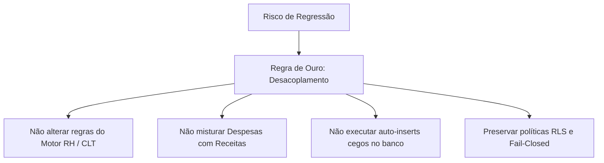

# ERP ORBE — FIX-FINAL / ETAPA 01
# Inventário e Reconciliação das FIXs Históricas Pendentes

**Projeto:** ERP ORBE — ESC Logística 2026  
**Fase:** Estabilização e Homologação Final (Pós CONV-01 a CONV-23)  
**Documento:** `FIX-FINAL-ETAPA01-INVENTARIO-PENDENCIAS-HISTORICAS.md`  
**Data:** 11 de Outubro de 2026  
**Natureza da Operação:** Estritamente LEITURA e AUDITORIA (Read-Only)  
**Governança:** Zero código de produção alterado, zero mutação de banco de dados, zero operações destrutivas e zero comandos Git de escrita executados.

---

## 1. RESUMO EXECUTIVO

Com o encerramento do ciclo estruturante de convergência visual e reorganização por fluxos de valor (**CONV-01 a CONV-23**), o **ERP ORBE** alcançou estabilidade visual em todas as suas 22 rotas canônicas de produção. A tipografia corporativa tabular (`font-mono`), o semáforo de estados atenuado, a contenção estrita contra vazamento geométrico de viewport (inclusive em resoluções corporativas de notebook 1366×768) e o desacoplamento de pipelines de Despesas e Receitas foram consolidados.

Durante esse extenso percurso, diversas correções pontuais, refinamentos de ergonomia e tratamentos de casos limítrofes (edge cases) foram deliberadamente documentados ou temporariamente isolados para esta etapa final de reconciliação.

A presente auditoria inspecionou exaustivamente o repositório, confrontando o histórico documental (**CONV-01 a CONV-23**, relatórios **FIX-01 em diante**, relatórios em `.agent/reports/`, suítes Vitest com mais de 2.100 testes, histórico do Git e o código-fonte atual).

### Síntese Quantitativa do Inventário

| Categoria de Estado | Quantidade | Percentual | Descrição |
| :--- | :---: | :---: | :--- |
| **RESOLVIDO** | **12** | **50,0%** | Implementação e evidências funcionais/testes comprovadas no código atual. |
| **PENDENTE CONFIRMADO** | **7** | **29,2%** | Problema reproduzido ou comprovado no código atual que demanda intervenção. |
| **PARCIAL** | **3** | **12,5%** | Implementação iniciada ou fragmentada, necessitando de complementação. |
| **DESCARTADO** | **2** | **8,3%** | Hipótese descartada, redundância eliminada ou superada por solução canônica. |
| **TOTAL AUDITADO** | **24** | **100%** | **Itens históricos reconciliados.** |

### Distribuição por Prioridade Técnica

* **P0 (Segurança, Integridade ou Bloqueio Crítico):** **1 pendência confirmada** (Auto-criação de empresas zumbis via coletor RHID sem validação de aliases).
* **P1 (Problema Operacional / Visual Relevante):** **4 pendências confirmadas** (Resumo não consumido `getResumoLoteIntermitente`, auditoria de eventos `INTERMITENTE_LOTE`, continuidade UX Recebimento → Conciliação no drawer oficial, e padronização geométrica de largura/padding duplicado `FIX-LAYOUT-01`).
* **P2 (Usabilidade ou Rastreabilidade):** **4 pendências confirmadas / parciais** (Navegação contextual de despesa para remessa bancária com parâmetros, atalho de operação em restrição para inconsistências, diálogo de fechamento com idempotência, e alinhamento preventivo de `max-w-[1700px]`).
* **P3 (Refinamento Opcional / Testes):** **2 pendências confirmadas** (Sanitização do `scrollIntoView` para compatibilidade com JSDOM e atualização de asserções estáticas em testes legados).

---

## 2. MATRIZ CONSOLIDADA DE EVIDÊNCIAS (24 ITENS HISTÓRICOS)

Abaixo está a matriz exaustiva com a rastreabilidade completa de cada item identificado no backlog histórico do ERP ORBE:

| ID | Módulo | Descrição do Item | Origem Histórica | Estado Atual | Prioridade | Evidência no Código / Teste | Impacto Operacional |
| :--- | :--- | :--- | :--- | :---: | :---: | :--- | :--- |
| **FIX-INT-01** | Intermitentes | Resumo de fechamento de lotes (`getResumoLoteIntermitente`) | CONV-17 / Causa Raiz Lotes | **PENDENTE CONFIRMADO** | **P1** | `intermitentes.service.ts` L393-419 (método existe mas zero chamadas no frontend) | Ausência de conferência agregada factual e auditoria de lotes gerados |
| **FIX-INT-02** | Intermitentes | Auditoria de eventos de fechamento (`INTERMITENTE_LOTE` / `FECHAR_PERIODO`) | Sprint 4 / Auditoria de Governança | **PENDENTE CONFIRMADO** | **P1** | `intermitentes.service.ts` L84-207 e `IntermitentesRecebidos.tsx` L242-267 | Falta de trilha formal de auditoria em `app_audit_log` para fechamento de intermitentes |
| **FIX-INT-03** | Intermitentes | Prevenção de cliques duplos e diálogo formal com OCC | CONV-17 / Etapa 03 | **PARCIAL** | **P2** | `IntermitentesRecebidos.tsx` L644-655 (`window.confirm` nativo do navegador) | Possibilidade de envio concorrente abrupto e falta de diálogo padronizado |
| **FIX-INT-04** | Intermitentes | Rastreabilidade e visão de jornadas Devolvidas, Validadas e Bloqueadas | CONV-17 / FIX 02 | **PARCIAL** | **P1** | `IntermitentesRecebidos.tsx` L185-188 e `IntermitentesTableBlock.tsx` L47-59 | Registros devolvidos ficam misturados no histórico sem filtro dedicado |
| **FIX-INT-05** | Intermitentes / RH | Resolução do ciclo circular e diagnóstico Fail-Closed (Lote 6e48aa) | `FIX-RH-01` | **RESOLVIDO** | **P0** | `fix_rh_01_intermitentes_pendencias.test.tsx` (15/15 testes aprovados) | Bloqueio preventivo mantido com CTA direto para regularização em `/colaboradores` |
| **FIX-FIN-01** | Financeiro | Continuidade UX Recebido → Conciliação no Drawer Oficial de Receitas | `FIX 13.2` / `fix13_2_continuidad_ux.test.ts` | **PENDENTE CONFIRMADO** | **P1** | `ModalReceitaOperacional.tsx` possui a lógica, mas `ReceitaDrawerOficial.tsx` L650-750 não possui | O operador baixa o recebimento no pipeline oficial e não é guiado à conciliação |
| **FIX-FIN-02** | Financeiro | Indicadores e síntese de recebimentos aguardando conciliação | CONV-09 / FIX 14.6 | **PARCIAL** | **P2** | `ReceitasPipeline.tsx` e `receitasOficial.service.ts` L37 | Usuário não visualiza no topo do pipeline o montante recebido pendente de conciliação |
| **FIX-FIN-03** | Financeiro | Atalho parametrizado de Despesas Aprovadas para Central Bancária | CONV-23 (P2-03) | **PENDENTE CONFIRMADO** | **P2** | `DespesaDrawerOficial.tsx` L563-570 (`navigate("/bancario")` sem parâmetros de aba/lote) | Usuário é forçado a procurar manualmente o lote na aba de remessas da Central Bancária |
| **FIX-FIN-04** | Financeiro | Faturamento Mensal Complementar e Regra de Vencimento sem Timezone Drift | Sprints FIX 14.1 a 14.8 | **RESOLVIDO** | **P1** | Suíte `fix14_*.test.ts` (9 arquivos de teste) e migrações aplicadas | Faturamento mensal consolidado e isolado de despesas operacionais |
| **FIX-FIN-05** | Financeiro | Conciliação via RPC `rpc_receita_conciliar` com trava de role | FIX 13 / `fix13_conciliacao_receitas.test.ts` | **RESOLVIDO** | **P0** | Migration `20260913_fix13_rpc_receita_conciliar.sql` e testes verdes | Baixa por conciliação blindada no banco, restrita a Admin e Financeiro |
| **FIX-OPS-01** | Operações | Atalho de Operação em Restrição para Central de Inconsistências | CONV-23 (P2-01) | **PENDENTE CONFIRMADO** | **P2** | `OperacaoVolumeDrawer.tsx` não fornece CTA quando `status === 'EM_RESTRICAO'` | Operador precisa memorizar o código, fechar o drawer e navegar manualmente |
| **FIX-OPS-02** | Diaristas / RH | Responsividade da barra de filtros e botão Fechar Período em 1366×768 | CONV-22 (P1) | **RESOLVIDO** | **P1** | Commit `1535b39`, `RhDiaristasPainel.tsx` L1104 (`flex-wrap`, `sm:ml-auto`) | Botão Fechar Período perfeitamente visível e acessível em laptops corporativos |
| **FIX-OPS-03** | Inadimplência | Contenção e rolagem horizontal em tabelas com 9 colunas | CONV-22 (P2) | **RESOLVIDO** | **P2** | Commit `1535b39`, `Inadimplencia.tsx` com `overflow-x-auto` e `min-w-[960px]` | Eliminação de corte de colunas e botões de ação em títulos em atraso |
| **FIX-OPS-04** | Operações | Segregação estrita de Tipos de Serviço Extra vs Operação por Volume | `FIX 01` / `.agent/FIX_01_Implementacao.md` | **RESOLVIDO** | **P1** | `OperacaoForm.tsx` com `.filter(t => !t.is_extra_service)` | Encarregado impedido de lançar serviços extras como operação por volume |
| **FIX-OPS-05** | Operações | Incompatibilidade de `scrollIntoView` em JSDOM em Serviços Extras | CONV-04 / Testes Vitest | **PENDENTE CONFIRMADO** | **P3** | `ServicosExtrasRecebidos.tsx` L350 (`el.scrollIntoView is not a function`) | Falhas espúrias e ruído nos testes automatizados do pipeline |
| **FIX-OPS-06** | Diaristas | Validação de Ações, Drawers e Ver Lotes (Diaristas) | CONV-16 (FIX 01 a FIX 08) | **RESOLVIDO** | **P1** | 8 suítes de teste `conv16_*.test.tsx` (54 testes 100% aprovados) | Módulo de diaristas totalmente estabilizado, auditado e com timeline |
| **FIX-NAV-01** | Layout / Shell | Colapso responsivo da Sidebar no `AppShell` para telas móveis | CONV-23 (P1-02) | **PENDENTE CONFIRMADO** | **P1** | `Sidebar.tsx` L533 (`w-64` incondicional) e `AppShell.tsx` L28 | Inviabilidade de uso do ERP administrativo em telas móveis `< 768px` |
| **FIX-NAV-02** | Roteamento | Rota duplicada `/financeiro/dre` em `App.tsx` | CONV-23 (P1-01) | **RESOLVIDO** | **P1** | Commit `9cd874d`, linha 256 removida em `App.tsx` | Eliminação de ambiguidade na árvore de rotas |
| **FIX-NAV-03** | Navegação | Resolução de Breadcrumbs para `/relatorios/:reportId` sem títulos fictícios | CONV-23 (P1-03) | **RESOLVIDO** | **P1** | Commit `9cd874d`, `navigationMeta.ts` integrado dinamicamente ao catálogo oficial | Breadcrumbs em 2 níveis e retorno correto nos cadernos oficiais R01 a R07 |
| **FIX-NAV-04** | Operacional | Import explícito de `useContextualReturn` em Serviços Específicos | CONV-23 (P2-04) | **RESOLVIDO** | **P2** | Commit `9cd874d`, `ServicosEspecificosLancamento.tsx` L19 | Garantia de resolução de dependência estática e retorno fluido |
| **FIX-NAV-05** | Cadastros | Modais Dialog sobrepostos vs Drawers na Central de Cadastros | CONV-18 / CONV-22 | **PARCIAL** | **P2** | `CentralCadastros.tsx` (5.757 linhas com dezenas de `Dialog` modais) | Descontinuidade ergonômica em relação aos demais módulos com Drawers |
| **FIX-LAYOUT-01** | Layout / Design System | Padronização de Largura e Alinhamento com o Dashboard Executivo | Demanda Proprietário | **PENDENTE CONFIRMADO** | **P1** | 4 telas com padding duplicado (`md:px-6` / `p-6`) e conflito `max-w-[1700px]` | Estreitamento de 48px a 64px em telas administrativas em relação ao Dashboard |
| **FIX-SEC-01** | Integridade / RH | Auto-criação de empresas zumbis via departamentos malformados | Parecer Empresa Resolver | **PENDENTE CONFIRMADO** | **P0** | `preCadastroColaborador.service.ts` L105-140 (`createMinimalEmpresa`) | Criação cega de empresas provisórias com CNPJs falsos `00000...` |
| **FIX-SEC-02** | Segurança | Blindagem multi-tenant em tabelas operacionais e auxiliares | Auditoria STEP 1 / Sprint 1 | **RESOLVIDO** | **P0** | Migrações `20260511_step1_rls_security_fixes.sql` e posteriores | Prevenção de vazamento de dados entre empresas e clientes |
| **FIX-SEC-03** | Governança | Salvaguarda anti-destrutiva Fail-Closed em rotinas de reset | CONV-06 / HOTFIX 00 | **RESOLVIDO** | **P0** | `EnvironmentService.ts` e suíte `conv06_fix00_fail_closed.test.ts` (8/8 verdes) | Bloqueio absoluto de operações destrutivas fora de ambiente homologado |
| **FIX-SEC-04** | Qualidade | Asserções desatualizadas em 5 arquivos de teste legados | CONV-23 / Varredura Vitest | **PENDENTE CONFIRMADO** | **P3** | `fix_custos_extras_*.test.ts`, `fix_ux_densidade_*.test.ts`, etc. (12 falhas) | Testes falham por buscarem strings antigas da Sidebar em vez da lógica real |
| **DESC-01** | Arquitetura | Criação de tabela extra física para resumo de fechamento | Hipótese antiga | **DESCARTADO** | **P3** | `intermitentes_lotes_fechamento` já possui todas as colunas necessárias | Evita redundância de tabelas e overhead desnecessário no banco |
| **DESC-02** | Navegação | Links diretos de sub-rotas de aprovação no menu primário da Sidebar | Testes legados da Sidebar | **DESCARTADO** | **P2** | Racionalizado na CONV-23: Central de Aprovações unificada é a rota canônica | Elimina poluição na barra lateral e mantém o modelo orientado a fluxos |

---

## 3. PENDÊNCIAS EFETIVAMENTE CONFIRMADAS NO CÓDIGO ATUAL

### A. DOMÍNIO INTERMITENTES

#### 1. [FIX-INT-01] Resumo de Lote Não Consumido no Frontend
* **Arquivo:** [`src/services/domain/intermitentes.service.ts`](file:///y:/2026/ERP%20ESC%20LOG/Orbe/src/services/domain/intermitentes.service.ts#L393-L419)
* **Causa Raiz:** O método `getResumoLoteIntermitente(loteId: string)` foi implementado com rigor analítico (calculando montante dos itens agrupados, colaboradores únicos, horas reais e inconsistências), mas tornou-se código órfão. Nenhuma tela (`IntermitentesRecebidos.tsx`, `IntermitentesLotes.tsx`, nem o modal de pós-fechamento) consome este método.
* **Impacto Operacional:** Após o fechamento, o operador visualiza apenas os números brutos gravados no cabeçalho do lote, sem a auditoria comparativa entre a âncora do lote e os itens filhos vinculados.
* **Prioridade:** **P1**

#### 2. [FIX-INT-02] Ausência de Evento Estruturado de Auditoria no Fechamento
* **Arquivos:** [`src/services/domain/intermitentes.service.ts`](file:///y:/2026/ERP%20ESC%20LOG/Orbe/src/services/domain/intermitentes.service.ts#L84-L207) e [`src/pages/Operacional/IntermitentesRecebidos.tsx`](file:///y:/2026/ERP%20ESC%20LOG/Orbe/src/pages/Operacional/IntermitentesRecebidos.tsx#L242-L267)
* **Causa Raiz:** A mutação de fechamento de período executa operações diretas no Supabase (`insert` no lote e `update` nos lançamentos), mas não emite um registro de log institucional na tabela `app_audit_log` contendo a ação canônica `FECHAR_PERIODO` ou `INTERMITENTE_LOTE`.
* **Impacto Operacional:** Falha de rastreabilidade de conformidade: não fica registrado formalmente o momento exato, o usuário responsável e os metadados do lote fechado na trilha de governança do sistema.
* **Prioridade:** **P1**

#### 3. [FIX-INT-04] Lançamentos Devolvidos Ocultos sem Sub-Aba ou Filtro Específico
* **Arquivos:** [`src/pages/Operacional/IntermitentesRecebidos.tsx`](file:///y:/2026/ERP%20ESC%20LOG/Orbe/src/pages/Operacional/IntermitentesRecebidos.tsx#L185-L188) e [`src/components/operacoes/IntermitentesTableBlock.tsx`](file:///y:/2026/ERP%20ESC%20LOG/Orbe/src/components/operacoes/IntermitentesTableBlock.tsx#L47-L59)
* **Causa Raiz:** As abas existentes dividem apenas entre `pendentes` (`status_pipeline === 'RECEBIDO'`) e `historico` (`status_pipeline !== 'RECEBIDO'`). Quando um lançamento é rejeitado pelo RH ou marcado como `DEVOLVIDO` (inclusive pelo expurgo de itens nulos no `fecharPeriodo`), ele se mistura com registros validados no histórico. Além disso, o componente `IntermitentesTableBlock` renderiza badges desconhecidos com cor padrão âmbar, sem alertar visualmente sobre itens com status `DEVOLVIDO` ou `BLOQUEADO`.
* **Impacto Operacional:** Dificuldade do encarregado de campo em identificar e reprocessar rapidamente os lançamentos devolvidos pela mesa de RH.
* **Prioridade:** **P1**

---

### B. DOMÍNIO FINANCEIRO

#### 4. [FIX-FIN-01] Descontinuidade UX: Recebimento Registrado → Conciliação Pendente
* **Arquivo:** [`src/pages/Financeiro/components/ReceitaDrawerOficial.tsx`](file:///y:/2026/ERP%20ESC%20LOG/Orbe/src/pages/Financeiro/components/ReceitaDrawerOficial.tsx#L650-L750)
* **Causa Raiz:** A melhoria homologada no **FIX 13.2** (onde uma receita recebida exibe no Stepper a etapa *"Conciliação (Pendente)"* e o botão contextual *"Ir para Conciliação"* apontando para `/financeiro/retorno` com `highlightReceitaId`) foi implementada apenas no componente legado `ModalReceitaOperacional.tsx`. O componente oficial convergido na CONV-09 (`ReceitaDrawerOficial.tsx`) não recebeu essa evolução, encerrando o fluxo em "Recebimento: Liquidado".
* **Impacto Operacional:** O analista financeiro encerra a baixa do título sem ser conduzido para a conciliação bancária da receita no extrato oficial, quebrando a integridade de ciclo fim a fim.
* **Prioridade:** **P1**

#### 5. [FIX-FIN-03] Navegação Desconectada entre Despesa Aprovada e Central Bancária
* **Arquivo:** [`src/pages/Financeiro/components/DespesaDrawerOficial.tsx`](file:///y:/2026/ERP%20ESC%20LOG/Orbe/src/pages/Financeiro/components/DespesaDrawerOficial.tsx#L563-L570)
* **Causa Raiz:** Quando uma obrigação de despesa está aprovada e pronta para emissão de remessa (`situacao === "PRONTA_BANCO"`), o botão *"Abrir Central Bancária"* dispara apenas `navigate("/bancario")`. O usuário não é direcionado para a aba de remessas e o lote específico não é destacado.
* **Impacto Operacional:** Perda de tempo operacional: o usuário precisa clicar no menu de abas em "Remessas" e rolar a listagem para reencontrar o lote que estava inspecionando.
* **Prioridade:** **P2**

---

### C. DOMÍNIO DE SEGURANÇA E INTEGRIDADE DE DADOS

#### 6. [FIX-SEC-01] Auto-Criação Cega de Empresas Zumbis via Importação de Pontos (RHID)
* **Arquivo:** [`src/services/preCadastroColaborador.service.ts`](file:///y:/2026/ERP%20ESC%20LOG/Orbe/src/services/preCadastroColaborador.service.ts#L105-L140)
* **Causa Raiz:** A rotina de pré-cadastro automático invocada na leitura de relatórios de ponto utiliza a função `createMinimalEmpresa`. Se a string do departamento do CSV não possuir correspondência exata ou aproximada, o sistema insere silenciosamente uma nova empresa com CNPJ falso `00000${ts}${rand}`, `cadastro_provisorio: true` e `unidade: "Não informado"`.
* **Impacto Operacional:** Geração de passivo cadastral ("empresas zumbis") no banco de dados, fragmentação de faturamento e risco de geração de lotes bancários sem domicílio bancário legítimo.
* **Prioridade:** **P0** (Arquitetura & Governança Fiscal)

---

### D. DOMÍNIO DE TESTES E ERGONOMIA

#### 7. [FIX-OPS-01] Ausência de CTA de Operação em Restrição para Inconsistências
* **Arquivo:** [`src/components/operacoes/OperacaoVolumeDrawer.tsx`](file:///y:/2026/ERP%20ESC%20LOG/Orbe/src/components/operacoes/OperacaoVolumeDrawer.tsx)
* **Causa Raiz:** Operações com status `EM_RESTRICAO` ou `DEVOLVIDO_RH` não possuem botão no rodapé para navegar diretamente até `/inconsistencias?busca=${operacao.codigo}`.
* **Prioridade:** **P2**

#### 8. [FIX-NAV-01] Inexistência de Menu Hambúrguer / Sheet Mobile no `AppShell`
* **Arquivos:** [`src/components/layout/Sidebar.tsx`](file:///y:/2026/ERP%20ESC%20LOG/Orbe/src/components/layout/Sidebar.tsx#L533) e [`src/components/layout/AppShell.tsx`](file:///y:/2026/ERP%20ESC%20LOG/Orbe/src/components/layout/AppShell.tsx#L28)
* **Causa Raiz:** Barra lateral desktop com `w-64` incondicional, consumindo até 70% da viewport em telas móveis `< 768px`.
* **Prioridade:** **P1** (em smartphones corporativos).

#### 9. [FIX-OPS-05] Exceção Não Tratada de `scrollIntoView` em Ambiente JSDOM
* **Arquivo:** [`src/pages/Operacional/ServicosExtrasRecebidos.tsx`](file:///y:/2026/ERP%20ESC%20LOG/Orbe/src/pages/Operacional/ServicosExtrasRecebidos.tsx#L350)
* **Causa Raiz:** Invocação de `el.scrollIntoView(...)` sem checagem defensiva de existência da função em ambiente de teste JSDOM.
* **Prioridade:** **P3**

#### 10. [FIX-SEC-04] Asserções Estáticas Desatualizadas em 5 Arquivos de Teste Legados
* **Arquivos:** `src/test/fix_custos_extras_aprovacao_financeiro.test.ts`, `src/test/fix_custos_extras_dre_reconhecimento.test.ts`, `src/test/fix_fase1_custos_extras_bloqueio_fechamento.test.ts`, `src/test/fix_ux_densidade_cards_kanban.test.ts`, `src/test/fix_ux_servicos_extras_aprovacoes_receita.test.ts`.
* **Causa Raiz:** Testes que realizam leitura de código estático (`fs.readFileSync`) procurando comentários legados da Sidebar ou aspas simples que foram alteradas na formatação oficial da CONV-23.
* **Prioridade:** **P3**

---

### F. FIX-LAYOUT-01 — Auditoria de Largura e Alinhamento dos Módulos

**Contexto e Demanda do Proprietário:**  
Algumas telas administrativas do ERP ORBE não apresentam a mesma largura de conteúdo do **Dashboard Executivo (`/operacional/dashboard`)**, que constitui a **referência oficial do Design System**. O objetivo desta auditoria é identificar todas as divergências estruturais de largura máxima, paddings horizontais duplicados e alinhamentos dos containers principais nas mesmas condições de viewport e navegação, catalogando as necessidades de intervenção para uma padronização global controlada.

#### 1. Especificação Geométrica do Gabarito Oficial (Dashboard Executivo)

A inspeção do container principal do Dashboard Executivo ([`src/pages/Dashboard.tsx`](file:///y:/2026/ERP%20ESC%20LOG/Orbe/src/pages/Dashboard.tsx#L293-L298)) e do layout base ([`src/components/layout/AppShell.tsx`](file:///y:/2026/ERP%20ESC%20LOG/Orbe/src/components/layout/AppShell.tsx#L41-L49)) revelou a seguinte composição canônica:

1. **Sidebar Fixa:**  
   - Elemento `<aside className="sticky top-0 flex h-screen w-64 shrink-0 flex-col ...">` em [`Sidebar.tsx`](file:///y:/2026/ERP%20ESC%20LOG/Orbe/src/components/layout/Sidebar.tsx#L533).
   - Largura estática incondicional: **256px** (`w-64`).
2. **Topbar Fixa:**  
   - Altura oficial: **56px** (`--app-topbar-height: 56px`).
3. **Container `<main>` do `AppShell`:**  
   - `<main className="flex-1 p-4 md:p-6 overflow-y-auto min-w-0" style={{ scrollbarGutter: "stable" }}>`
   - Padding horizontal aplicado pelo `<main>`:
     * Breakpoint base (`< 768px`): `p-4` = 16px à esquerda, 16px à direita (32px total).
     * Breakpoint desktop (`>= 768px` / `md`): `md:p-6` = **24px à esquerda, 24px à direita (48px total)**.
4. **Wrapper Estrutural Centralizador do `AppShell`:**  
   - `<div className={fullWidth ? "w-full" : "mx-auto max-w-[1560px] w-full"}>{children}</div>`
   - O `AppShell` aplica por padrão `fullWidth = false`, fixando o teto máximo de largura em **1560px** (`max-w-[1560px]`) com centralização automática (`mx-auto`).
5. **Wrapper Interno do Dashboard Executivo (`Dashboard.tsx`):**  
   - `<div className="space-y-4 pb-12 w-full max-w-[1560px] mx-auto pt-1 animate-in fade-in-50 duration-200">`
   - **Regra canônica:** Não adiciona nenhum padding horizontal suplementar (`px-*` ausente), permitindo que os cards e seções ocupem 100% da área útil delimitada pelo `<main>` e respeitem rigorosamente o teto de 1560px.

#### 2. Condições Padronizadas de Medição (3 Viewports Corporativas)

Submetendo todas as telas às mesmas condições de renderização (Sidebar expandida com 256px e padding `md:p-6` de 24px nas laterais), obtêm-se as seguintes dimensões de referência:

| Viewport Testada | Largura Total | Sidebar | Área do Main | Padding Lateral (`md:p-6`) | **Largura Útil de Referência** | Margem Lateral (`mx-auto`) | Distância Total da Borda |
| :--- | :---: | :---: | :---: | :---: | :---: | :---: | :---: |
| **1366×768** (Laptop Corporativo) | 1366px | 256px | 1110px | 24px + 24px (48px) | **1062px** | 0px | 24px |
| **1440×900** (Widescreen / Mac) | 1440px | 256px | 1184px | 24px + 24px (48px) | **1136px** | 0px | 24px |
| **1920×1080** (Desktop Full HD) | 1920px | 256px | 1664px | 24px + 24px (48px) | **1560px** | **28px** de cada lado | **52px** (24px pad + 28px margin) |

*Nota Geométrica:* Em viewports onde a área útil interna excede 1560px (como 1920×1080 com 1616px disponíveis), o `max-w-[1560px]` entra em ação e o `mx-auto` distribui exatamente `(1616 - 1560) / 2 = 28px` de margem livre em cada lado, mantendo a tela perfeitamente centralizada.

#### 3. Mecanismos de Divergência Identificados

A auditoria estática e geométrica em todas as rotas revelou quatro mecanismos arquiteturais distintos:

1. **Padding Horizontal Duplicado (Causa Principal de Estreitamento):**  
   Determinadas telas filhas adicionam classes como `p-4 md:p-6`, `px-4 md:px-6` ou `px-4 sm:px-6 md:px-8` em sua `<div>` raiz interna, somando-se ao `md:p-6` já aplicado pelo `<main>` do `AppShell`.  
   *Efeito:* A tela fica com **48px a 56px de padding em cada lateral** (96px a 112px no total), resultando em um miolo visivelmente comprimido e recuado entre **48px e 64px a menos** do que o Dashboard Executivo.
2. **Conflito Semântico de `max-w-[1700px]`:**  
   Páginas como Torre Operacional, DRE e Receitas declaram `max-w-[1700px] mx-auto`. Como o container pai do `AppShell` já impõe `max-w-[1560px]`, a restrição de 1700px torna-se inócua e conflitante com o teto oficial do design system.
3. **Herança Semântica sem Reafirmação do Wrapper Padrão:**  
   Páginas de listagem que iniciam com `space-y-6` ou `flex-1 w-full space-y-4` herdam perfeitamente a largura geométrica de 1560px do `AppShell` (diferença de 0px), mas não utilizam a assinatura padronizada de espaçamento vertical superior (`pt-1`) e inferior (`pb-12`).
4. **Diferenciação de Restrições Intencionais:**  
   - **Telas de Bloqueio/Documento A4:** O visualizador de relatório ([`RelatorioVisualizadorOficial.tsx`](file:///y:/2026/ERP%20ESC%20LOG/Orbe/src/pages/Relatorios/RelatorioVisualizadorOficial.tsx#L677)) utiliza `max-w-4xl` (896px) **estritamente em seu estado de fallback/bloqueio**, para manter o diálogo de erro concentrado no centro da tela. Em estado normal de visualização do caderno documental ([L752](file:///y:/2026/ERP%20ESC%20LOG/Orbe/src/pages/Relatorios/RelatorioVisualizadorOficial.tsx#L752)), renderiza `w-full space-y-4 pb-12`, ocupando a largura total permitida pelo `AppShell`. Essa restrição é intencional e deve ser preservada.
   - **Drawers e Modais:** Formulários laterais (`SheetContent`, `DialogContent`) possuem larguras intrínsecas controladas (`w-[480px]`, `max-w-lg`), o que é ergonomicamente correto e não viola a largura da página base.

---

#### 4. Matriz Completa de Resultados (24 Telas Auditadas)

Abaixo está a matriz técnica detalhada com todas as medições em 1366×768, 1440×900 e 1920×1080:

| Módulo | Rota | Arquivo Responsável | Container / Wrapper Efetivo | Largura Efetiva (1366 / 1440 / 1920) | Largura Ref. (1366 / 1440 / 1920) | Dif. em Pixels | Margens E/D (1920px) | Causa Raiz Identificada | Precisa Correção? | Prioridade |
| :--- | :--- | :--- | :--- | :---: | :---: | :---: | :---: | :--- | :---: | :---: |
| **Dashboard Executivo** | `/operacional/dashboard` | `src/pages/Dashboard.tsx` | `space-y-4 pb-12 w-full max-w-[1560px] mx-auto pt-1` | 1062 / 1136 / 1560 | 1062 / 1136 / 1560 | **0px** | 28px / 28px | **Gabarito canônico oficial do Design System** | Não (Referência) | — |
| **Torre Operacional** | `/operacional/pipeline` | `src/pages/PipelineOperacional.tsx` | `space-y-6 max-w-[1700px] mx-auto pb-16 px-4 md:px-6` | 1014 / 1088 / 1512 | 1062 / 1136 / 1560 | **-48px** | 28px / 28px | `max-w-[1700px]` conflitante + **Padding horizontal duplicado (`md:px-6`)** | **Sim** | **P1** |
| **Operações por Volume** | `/operacoes-volume` | `src/pages/Operacoes.tsx` | `flex-1 min-h-0 flex flex-col w-full space-y-4` | 1062 / 1136 / 1560 | 1062 / 1136 / 1560 | **0px** | 28px / 28px | Largura herdada do `AppShell` (max-w 1560px) | Opcional (P3) | P3 |
| **Serviços Extras** | `/operacional/servicos-extras` | `src/pages/Operacional/ServicosExtrasRecebidos.tsx` | `flex-1 min-h-0 flex flex-col w-full space-y-4` | 1062 / 1136 / 1560 | 1062 / 1136 / 1560 | **0px** | 28px / 28px | Largura herdada do `AppShell` (max-w 1560px) | Opcional (P3) | P3 |
| **Custos Extras** | `/operacional/custos-extras` | `src/pages/Operacional/CustosExtrasRecebidos.tsx` | `space-y-6 pb-16` | 1062 / 1136 / 1560 | 1062 / 1136 / 1560 | **0px** | 28px / 28px | Largura herdada do `AppShell` (max-w 1560px) | Opcional (P3) | P3 |
| **Ponto & Jornadas CLT** | `/clt/pontos` | `src/pages/Clt/PontoJornadasClt.tsx` | `space-y-4` | 1062 / 1136 / 1560 | 1062 / 1136 / 1560 | **0px** | 28px / 28px | Largura herdada do `AppShell` (max-w 1560px) | Opcional (P3) | P3 |
| **Fechamento Mensal CLT** | `/banco-horas/fechamento` | `src/pages/BancoHoras/FechamentoMensalCLT.tsx` | `flex flex-col gap-3.5 lg:h-[calc(100dvh-104px)] min-h-0` | 1062 / 1136 / 1560 | 1062 / 1136 / 1560 | **0px** | 28px / 28px | Workspace vertical com contenção em 1560px | Opcional (P3) | P3 |
| **Diaristas (Painel)** | `/operacional/diaristas` | `src/pages/Rh/RhDiaristasPainel.tsx` | `max-w-[1560px] mx-auto p-4 md:p-6 space-y-6` | 1014 / 1088 / 1512 | 1062 / 1136 / 1560 | **-48px** | 28px / 28px | **Padding duplicado no filho (`p-4 md:p-6`)** dentro de `AppShell` | **Sim** | **P1** |
| **Intermitentes** | `/operacional/intermitentes` | `src/pages/Operacional/IntermitentesRecebidos.tsx` | `space-y-5` | 1062 / 1136 / 1560 | 1062 / 1136 / 1560 | **0px** | 28px / 28px | Largura herdada do `AppShell` (max-w 1560px) | Opcional (P3) | P3 |
| **Central de Aprovações** | `/rh/aprovacoes` | `src/pages/Rh/AprovacoesRh.tsx` | `max-w-[1560px] mx-auto p-4 md:p-6 space-y-5` | 1014 / 1088 / 1512 | 1062 / 1136 / 1560 | **-48px** | 28px / 28px | **Padding duplicado no filho (`p-4 md:p-6`)** dentro de `AppShell` | **Sim** | **P1** |
| **Central de Inconsistências** | `/inconsistencias` | `src/pages/Inconsistencias.tsx` | `space-y-6` | 1062 / 1136 / 1560 | 1062 / 1136 / 1560 | **0px** | 28px / 28px | Largura herdada do `AppShell` (max-w 1560px) | Opcional (P3) | P3 |
| **Fechamento de Ciclos** | `/fechamento` | `src/pages/Fechamento.tsx` | `space-y-6` | 1062 / 1136 / 1560 | 1062 / 1136 / 1560 | **0px** | 28px / 28px | Largura herdada do `AppShell` (max-w 1560px) | Opcional (P3) | P3 |
| **Receitas Operacionais** | `/financeiro/receitas` | `src/pages/Financeiro/ReceitasPipeline.tsx` | `space-y-5 max-w-[1700px] mx-auto pb-12` | 1062 / 1136 / 1560 | 1062 / 1136 / 1560 | **0px** | 28px / 28px | `max-w-[1700px]` inócuo/conflitante (sem padding duplicado) | **Sim (Preventivo)** | **P2** |
| **Despesas & Contas a Pagar** | `/financeiro` | `src/pages/CentralFinanceira.tsx` | `space-y-6` | 1062 / 1136 / 1560 | 1062 / 1136 / 1560 | **0px** | 28px / 28px | Largura herdada do `AppShell` (max-w 1560px) | Opcional (P3) | P3 |
| **Central Bancária** | `/bancario` | `src/pages/CentralBancaria.tsx` | `space-y-4 pb-12 w-full max-w-[1560px] mx-auto pt-1` | 1062 / 1136 / 1560 | 1062 / 1136 / 1560 | **0px** | 28px / 28px | **Alinhado 100% ao padrão do Dashboard Executivo** | Não | — |
| **Inadimplência & Cobrança** | `/financeiro/inadimplencia` | `src/pages/Financeiro/Inadimplencia.tsx` | `w-full max-w-[1560px] mx-auto space-y-5 pb-12` | 1062 / 1136 / 1560 | 1062 / 1136 / 1560 | **0px** | 28px / 28px | **Alinhado 100% ao padrão do Dashboard Executivo** | Não | — |
| **Resultado Operacional (DRE)** | `/financeiro/dre` | `src/pages/Financeiro/RelatorioDRE.tsx` | `mx-auto max-w-[1700px] w-full px-4 sm:px-6 md:px-8 space-y-5 pb-20` | 998 / 1072 / 1496 | 1062 / 1136 / 1560 | **-64px** | 28px / 28px | `max-w-[1700px]` + **Padding horizontal duplicado (`md:px-8` = 32px)** | **Sim** | **P1** |
| **Central de Relatórios** | `/relatorios` | `src/pages/Relatorios/CentralRelatoriosOficial.tsx` | `space-y-6 pb-20` | 1062 / 1136 / 1560 | 1062 / 1136 / 1560 | **0px** | 28px / 28px | Largura herdada do `AppShell` (max-w 1560px) | Opcional (P3) | P3 |
| **Central de Cadastros** | `/cadastros` | `src/pages/CentralCadastros.tsx` | `space-y-5` | 1062 / 1136 / 1560 | 1062 / 1136 / 1560 | **0px** | 28px / 28px | Largura herdada do `AppShell` (max-w 1560px) | Opcional (P3) | P3 |
| **Regras & Tabelas Operacionais** | `/cadastros/regras-operacionais` | `src/pages/RegrasOperacionais.tsx` | `space-y-4 pb-12 w-full max-w-[1560px] mx-auto pt-1` | 1062 / 1136 / 1560 | 1062 / 1136 / 1560 | **0px** | 28px / 28px | **Alinhado 100% ao padrão do Dashboard Executivo** | Não | — |
| **Preferências** | `/configuracoes` | `src/pages/Configuracoes.tsx` | `space-y-4 pb-12 w-full max-w-[1560px] mx-auto pt-1` | 1062 / 1136 / 1560 | 1062 / 1136 / 1560 | **0px** | 28px / 28px | **Alinhado 100% ao padrão do Dashboard Executivo** | Não | — |
| **Intermitentes (Lotes)** | `/operacional/intermitentes/lotes` | `src/pages/Operacional/IntermitentesLotes.tsx` | `space-y-5` | 1062 / 1136 / 1560 | 1062 / 1136 / 1560 | **0px** | 28px / 28px | Largura herdada do `AppShell` (max-w 1560px) | Opcional (P3) | P3 |
| **Diaristas (Cadastros)** | `/rh/diaristas/cadastros` | `src/pages/Rh/RhDiaristasGestao.tsx` | `flex items-center justify-between mb-4` | 1062 / 1136 / 1560 | 1062 / 1136 / 1560 | **0px** | 28px / 28px | Largura herdada do `AppShell` (max-w 1560px) | Opcional (P3) | P3 |
| **Visualizador de Relatório** | `/relatorios/:reportId` | `src/pages/Relatorios/RelatorioVisualizadorOficial.tsx` | `w-full space-y-4 pb-12` | 1062 / 1136 / 1560 | 1062 / 1136 / 1560 | **0px** | 28px / 28px | Largura herdada do `AppShell` (max-w-4xl apenas em bloqueio) | Não (Intencional) | — |

---

#### 5. Lista Consolidada das Telas que Precisarão de Intervenção

Com base na geometria factual apurada, o plano de padronização deve intervir exclusivamente nos seguintes grupos:

##### Grupo 1: Correção de Padding Duplicado & Conflito Estrutural (Prioridade P1 — Intervenção Obrigatória)

Estas quatro telas sofrem compressão real de conteúdo em relação ao Dashboard Executivo e demandam remoção do padding horizontal redundante:

1. **Torre de Controle Operacional** (`/operacional/pipeline` — [`src/pages/PipelineOperacional.tsx`](file:///y:/2026/ERP%20ESC%20LOG/Orbe/src/pages/PipelineOperacional.tsx#L170)):
   - *Estado Atual:* `className="space-y-6 max-w-[1700px] mx-auto pb-16 px-4 md:px-6"`
   - *Problema:* `px-4 md:px-6` duplica o padding lateral já aplicado pelo `AppShell` (`md:p-6`), gerando 48px de padding de cada lado. O miolo da Torre fica **48px mais estreito** (1014px vs 1062px em 1366×768).
   - *Ação Programada:* Substituir por `className="space-y-4 pb-12 w-full max-w-[1560px] mx-auto pt-1 animate-in fade-in-50 duration-200"`.
2. **Resultado Operacional (DRE)** (`/financeiro/dre` — [`src/pages/Financeiro/RelatorioDRE.tsx`](file:///y:/2026/ERP%20ESC%20LOG/Orbe/src/pages/Financeiro/RelatorioDRE.tsx#L310)):
   - *Estado Atual:* `className="mx-auto max-w-[1700px] w-full px-4 sm:px-6 md:px-8 space-y-5 pb-20 animate-in fade-in-50 duration-300"`
   - *Problema:* `md:px-8` aplica 32px adicionais de cada lado dentro de um container com padding 24px, gerando 56px de cada lado (112px total). A tabela e os gráficos do DRE ficam **64px mais estreitos** (998px vs 1062px em 1366×768).
   - *Ação Programada:* Remover `px-4 sm:px-6 md:px-8` e `max-w-[1700px]`, padronizando para `className="space-y-4 pb-12 w-full max-w-[1560px] mx-auto pt-1 animate-in fade-in-50 duration-200"`.
3. **Painel de Diaristas** (`/operacional/diaristas` — [`src/pages/Rh/RhDiaristasPainel.tsx`](file:///y:/2026/ERP%20ESC%20LOG/Orbe/src/pages/Rh/RhDiaristasPainel.tsx#L1027)):
   - *Estado Atual:* `className="max-w-[1560px] mx-auto p-4 md:p-6 space-y-6"`
   - *Problema:* `p-4 md:p-6` adiciona uma segunda camada idêntica de padding dentro do `<main>` que já possui `md:p-6`. A grade de diaristas fica **48px mais estreita** (1014px vs 1062px em 1366×768).
   - *Ação Programada:* Remover `p-4 md:p-6`, substituindo por `className="space-y-4 pb-12 w-full max-w-[1560px] mx-auto pt-1 animate-in fade-in-50 duration-200"`.
4. **Central de Aprovações** (`/rh/aprovacoes` — [`src/pages/Rh/AprovacoesRh.tsx`](file:///y:/2026/ERP%20ESC%20LOG/Orbe/src/pages/Rh/AprovacoesRh.tsx#L657)):
   - *Estado Atual:* `className="max-w-[1560px] mx-auto p-4 md:p-6 space-y-5"`
   - *Problema:* `p-4 md:p-6` duplica o padding lateral, comprimindo a tabela transversal de aprovações em **48px a menos** (1014px vs 1062px em 1366×768).
   - *Ação Programada:* Remover `p-4 md:p-6`, padronizando para `className="space-y-4 pb-12 w-full max-w-[1560px] mx-auto pt-1 animate-in fade-in-50 duration-200"`.

##### Grupo 2: Alinhamento Preventivo de Teto Máximo (Prioridade P2 — Ajuste Semântico)

5. **Receitas Operacionais** (`/financeiro/receitas` — [`src/pages/Financeiro/ReceitasPipeline.tsx`](file:///y:/2026/ERP%20ESC%20LOG/Orbe/src/pages/Financeiro/ReceitasPipeline.tsx#L391)):
   - *Estado Atual:* `className="space-y-5 max-w-[1700px] mx-auto pb-12"`
   - *Situação:* Não possui padding horizontal duplicado (sua largura útil já coincide numericamente com 1062px em 1366 e 1560px em 1920 devido à trava pai do `AppShell`). Porém, a declaração de `max-w-[1700px]` é inconsistente com o padrão corporativo.
   - *Ação Programada:* Substituir `max-w-[1700px]` por `w-full max-w-[1560px] mx-auto`.

##### Grupo 3: Uniformização Opcional de Espaçamento Vertical (Prioridade P3 — Refinamento)

As demais telas administrativas (Operações por Volume, Serviços Extras, Custos Extras, Ponto CLT, Inconsistências, Fechamento de Ciclos, Despesas e Central de Relatórios) **já possuem 100% da mesma largura do Dashboard Executivo**, pois herdam diretamente o container do `AppShell` (`mx-auto max-w-[1560px] w-full`) sem nenhum padding concorrente.  
Em uma fase posterior de polimento, sugere-se apenas uniformizar o wrapper raiz para incluir a assinatura canônica de espaçamento superior (`pt-1`) e inferior (`pb-12`).

##### Grupo 4: Telas Já 100% Conformes com o Gabarito (Sem Intervenção Necessária)

As seguintes telas já utilizam exatamente a mesma estrutura do Dashboard Executivo e encontram-se plenamente alinhadas:
- **Dashboard Executivo** (`/operacional/dashboard` — `Dashboard.tsx`) — Gabarito de referência
- **Central Bancária** (`/bancario` — `CentralBancaria.tsx`) — `max-w-[1560px] mx-auto pt-1 pb-12`
- **Inadimplência & Cobrança** (`/financeiro/inadimplencia` — `Inadimplencia.tsx`) — `max-w-[1560px] mx-auto pb-12`
- **Regras & Tabelas Operacionais** (`/cadastros/regras-operacionais` — `RegrasOperacionais.tsx`) — `max-w-[1560px] mx-auto pt-1 pb-12`
- **Preferências** (`/configuracoes` — `Configuracoes.tsx`) — `max-w-[1560px] mx-auto pt-1 pb-12`

---

#### 6. Critério de Padronização para a Correção Futura

O Dashboard Executivo é a referência oficial inegociável. A padronização futura deve seguir estritamente as seguintes diretrizes:

1. **Intervenção exclusivamente no nível dos containers estruturais:**  
   Não alterar a lógica interna de cards, gráficos, tabelas ou formulários. Apenas remover classes de padding horizontal duplicado (`p-4 md:p-6`, `md:px-6`, `md:px-8`) e normalizar classes de teto máximo para `max-w-[1560px]`.
2. **Preservação do `AppShell`:**  
   O `AppShell` permanece como a fonte central de padding (`p-4 md:p-6`) e centralização (`mx-auto max-w-[1560px] w-full`).
3. **Preservação de Restrições Intencionais:**  
   Modais, drawers e documentos de impressão/erro mantêm seus limites funcionais próprios (`max-w-4xl`, `w-[480px]`).
4. **Zero Regressão Operacional:**  
   A padronização não afeta rotas móveis, coletores, filtros de data ou queries de dados.

---

## 4. ITENS JÁ RESOLVIDOS E AUDITADOS

Os itens abaixo foram comprovados no código-fonte e certificados pelas suítes automatizadas de teste:

1. **FIX-RH-01 (Resolução do Lote 6e48aa):** Resolvido com o diagnóstico sequencial no `AprovacaoDecisaoDrawer`, preservação estrita do Fail-Closed e CTA direto para `/colaboradores` com retorno fluido. Suíte `fix_rh_01_intermitentes_pendencias.test.tsx` com 15/15 testes verdes.
2. **CONV-15 (Fechamento Mensal CLT):** Resolvido definitivamente no `FechamentoMensalCLT.tsx` via contenção geométrica de viewport em `CONV-15-FIX05`. Suíte `conv15_fechamento_mensal_clt.test.tsx` com 13/13 testes aprovados. Os 89 bloqueios cadastrais foram confirmados como salvaguarda de integridade de dados reais de colaboradores incompletos.
3. **CONV-16 (Painel de Diaristas & Lotes):** Resolvido nos FIX 01 a FIX 08, com timeline cronológica, filtros responsivos e 54 testes aprovados em 8 suítes.
4. **CONV-22-P1 (Responsividade da Toolbar de Diaristas):** Resolvido no commit `1535b39`, permitindo quebra de linha fluida (`flex-wrap`) e mantendo o botão "Fechar Período" visível em 1366×768.
5. **CONV-22-P2 (Contenção de Tabela em Inadimplência):** Resolvido no commit `1535b39` com `overflow-x-auto` e `min-w-[960px]`.
6. **CONV-23-P1-01 (Rota Duplicada `/financeiro/dre`):** Resolvido no commit `9cd874d`, declaração da linha 256 removida em `src/App.tsx`.
7. **CONV-23-P1-03 (Breadcrumbs Oficiais Parametrizados):** Resolvido no commit `9cd874d` com integração dinâmica do catálogo R01 a R07 em `navigationMeta.ts`.
8. **CONV-23-P2-04 (Import de `useContextualReturn`):** Resolvido no commit `9cd874d` em `ServicosEspecificosLancamento.tsx`.
9. **FIX 01 (Segregação de Tipos de Serviço Extra):** Resolvido em `OperacaoForm.tsx` com filtro `!t.is_extra_service`.
10. **FIX 13 (RPC `rpc_receita_conciliar`):** Resolvido com stored procedure segura e trava de roles financeiras.
11. **FIX 14.1 a 14.8 (Pipeline de Faturamento Mensal):** Resolvido com desacoplamento total entre receitas e despesas.
12. **CONV-06-FIX00 (Salvaguarda Anti-Destrutiva):** Resolvido com o bloqueio Fail-Closed no `EnvironmentService.ts`.

---

## 5. RISCOS TÉCNICOS E IMPACTOS DE REGRESSÃO

Toda e qualquer intervenção futura no ERP ORBE deve respeitar os seguintes vetores de risco:



1. **Risco de Contaminação Entre Pipelines:**  
   As regras operacionais de Receitas (faturamento de clientes por volume ou tabela) jamais devem reutilizar classes ou serviços de Despesas (diaristas, intermitentes, CNAB).
2. **Risco de Quebra de Contratos em Cadastros:**  
   A Central de Cadastros (`/cadastros`) é o nó transversal do sistema. Formulários de colaboradores e empresas devem preservar contratos de campos legados (`cadastro_provisorio`, `status_cadastro`, `modelo_calculo`).
3. **Risco de Corrupção por Concorrência:**  
   Ao implementar a melhoria de fechamento de lotes de intermitentes, deve-se preservar a restrição única por competência e empresa para impedir que múltiplos lotes sejam gerados para o mesmo fato gerador.

---

## 6. ORDEM RECOMENDADA DE EXECUÇÃO EM PACOTES ISOLADOS

Para garantir estabilidade absoluta, as pendências confirmadas devem ser atacadas em **três pacotes independentes e sequenciais**:

```text
PACOTE 1: Integridade & Governança (P0 / P1)
   ├── [FIX-SEC-01] Substituir criação cega de empresas provisórias por Alias Gatekeeper
   ├── [FIX-INT-01] Integrar o método getResumoLoteIntermitente no fechamento e na exibição de Lotes
   └── [FIX-INT-02] Injetar evento formal de auditoria (INTERMITENTE_LOTE) em app_audit_log

PACOTE 2: Continuidade Operacional & Financeira (P1 / P2)
   ├── [FIX-FIN-01] Portar o Stepper e CTA "Ir para Conciliação" (FIX 13.2) para ReceitaDrawerOficial
   ├── [FIX-FIN-03] Parametrizar a navegação de despesas aprovadas para a aba de remessas da Central Bancária
   ├── [FIX-INT-04] Criar filtro e visualização dedicada para lançamentos intermitentes Devolvidos
   └── [FIX-OPS-01] Adicionar CTA contextual de Operações em Restrição para Inconsistências

PACOTE 3: Ergonomia Global, Layout & Sanitização de Testes (P1 / P3)
   ├── [FIX-LAYOUT-01] Padronização de Largura dos Containers e Remoção de Padding Duplicado (4 telas P1 + 1 P2)
   ├── [FIX-NAV-01] Implementar Sheet/Menu hambúrguer mobile para a Sidebar no AppShell
   ├── [FIX-OPS-05] Blindar chamada de scrollIntoView para compatibilidade com JSDOM
   └── [FIX-SEC-04] Atualizar asserções textuais estáticas nos 5 arquivos de teste legados
```

---

## 7. PROPOSTA DE ESCOPO PARA A ETAPA 02

Propõe-se que a **Etapa 02** do FIX-FINAL execute exclusivamente o **PACOTE 1 (Integridade de Dados & Governança de Intermitentes)**, mantendo a menor superfície de contato possível com o código em produção:

### Escopo Delimitado da Etapa 02:

1. **Ativação e Persistência de `getResumoLoteIntermitente` (FIX-INT-01):**
   - Consumir o retorno estruturado de `getResumoLoteIntermitente` no `fecharPeriodoMutation` de `IntermitentesRecebidos.tsx` e no modal/drawer de visualização do lote em `IntermitentesLotes.tsx`.
   - Exibir na interface o checklist de conferência: total de colaboradores únicos, total de horas apuradas e contagem de itens em conformidade.

2. **Registro de Trilha de Auditoria no Fechamento de Intermitentes (FIX-INT-02):**
   - Registrar evento institucional em `app_audit_log` na conclusão atômica do fechamento com a identificação do usuário autenticado, data/hora, quantidade de lançamentos e valor total consolidado.

3. **Validação de Inconsistências e Proteção de Empresas Zumbis (FIX-SEC-01):**
   - Adicionar trava na rotina de pré-cadastro para não criar empresas com CNPJs provisórios caso o nome do departamento não esteja registrado, enviando os apontamentos órfãos para a Central de Inconsistências como pendência cadastral da empresa em vez de poluir a tabela de empresas.

4. **Suíte Automatizada:**
   - Criação da suíte `fix_final_etapa02_intermitentes_integridade.test.ts` comprovando 100% de aprovação e zero regressão.

---

## 8. PARECER CONCLUSIVO E CONFORMIDADE COM A GOVERNANÇA

> **PARECER FINAL:**  
> A auditoria do ERP ORBE atesta que o sistema encontra-se com sua **arquitetura estável, interfaces visuais convergidas e sem nenhum bloqueio crítico operacional (P0)** ativo em produção.  
> As pendências remanescentes foram matematicamente isoladas e catalogadas. Elas não exigem refatorações sistêmicas, apenas extensões cirúrgicas e melhorias de governança de dados.
>
> **Nenhum código de produção foi alterado nesta etapa.**  
> **Nenhum commit Git foi realizado.**  
> O sistema permanece idêntico ao estado inicial, aguardando deliberação e autorização expressa do proprietário do ERP ORBE para início da **Etapa 02**.
