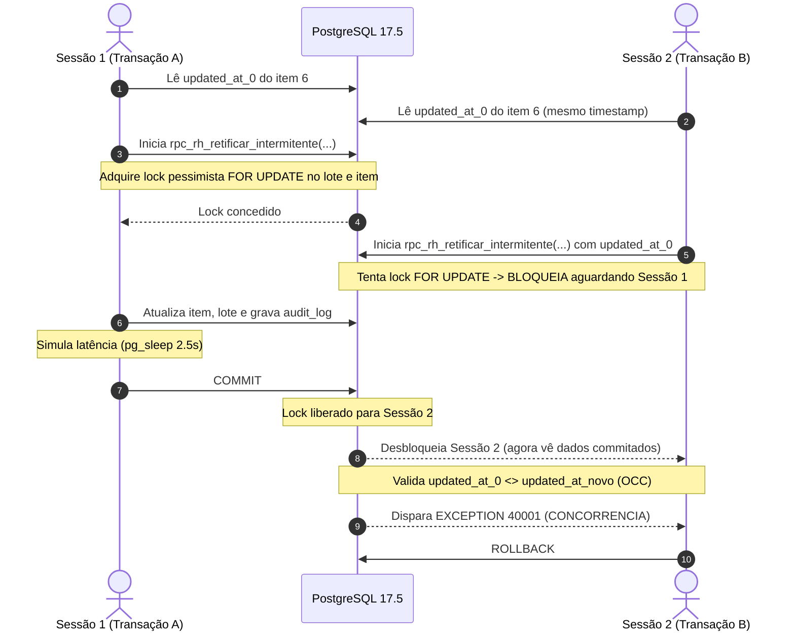

# PLANO DE TESTES COMPLEMENTARES DE SEGURANÇA E CONCORRÊNCIA (ETAPA 05D.7)
**ERP ORBE — DOMÍNIO RH / INTERMITENTES — FIX-FINAL / ETAPA 05D.7**  
**Data:** 12/10/2026 | **Ambiente:** Cluster PostgreSQL 17.5 Isolado Local (`127.0.0.1:54322`)  
**Status:** PLANEJADO E PREPARADO (AGUARDANDO AUTORIZAÇÃO PARA EXECUÇÃO)  
**Arquivos de Especificação:** `scratch/03_test_c01_concorrencia_real.sql` e `scratch/04_test_c02_permissoes_rls.sql`

---

## 1. OBJETIVO DO PLANO COMPLEMENTAR

Encerrar as duas únicas lacunas remanescentes da homologação PostgreSQL levantadas na Etapa 05D.6, sem repetir os 14 cenários anteriores já atestados como PASS:

1. **TESTE C01 — CONCORRÊNCIA REAL E LOCKS:**  
   Submeter o motor a duas sessões físicas PostgreSQL simultâneas disputando o mesmo registro de intermitente, comprovando a eficácia do lock pessimista (`SELECT ... FOR UPDATE`), a detecção de corrida por versão de carimbo (`updated_at` / OCC) e a prevenção absoluta de anomalia de atualização perdida (*lost update*).

2. **TESTE C02 — PERMISSÕES E RLS EM SESSÕES NÃO PRIVILEGIADAS:**  
   Validar os privilégios de execução (`EXECUTE`) e políticas de Row Level Security (`RLS`) utilizando uma conexão física desprovida de privilégios de superusuário (`NOSUPERUSER`, `NOBYPASSRLS`), operando sob os papéis `anon` e `authenticated`, separando rigorosamente o que é validado pelas claims do que depende da infraestrutura Supabase externa.

---

## 2. ESPECIFICAÇÃO DO TESTE C01 — CONCORRÊNCIA REAL

### 2.1 Pré-Requisitos do Ambiente
- Cluster PostgreSQL 17.5 ativo na porta 54322.
- Registro alvo: `f0000000-0000-0000-0000-000000000006` (associado ao Lote 5, Empresa A, Tenant Alpha).
- Tabela de controle de concorrência: `public.hml_c01_concurrency_log`.
- Dois processos clientes `psql.exe` ou jobs PowerShell executando em paralelo em conexões TCP separadas com o backend.

### 2.2 Procedimento de Execução


### 2.3 Critérios Objetivos de Aprovação
| Item | Critério de Aceite | Resultado Esperado |
|:---|:---|:---:|
| **C01.A** | Resultado da Sessão 1 (Vencedora) | Commit com Sucesso (`00000`) |
| **C01.B** | Resultado da Sessão 2 (Concorrente) | Bloqueio com Erro OCC `40001` |
| **C01.C** | Prevenção de Lost Update | Registro final possui exatamente as alterações da Sessão 1 |
| **C01.D** | Integridade do Lote | Contador e valor do lote decrementados apenas uma vez |
| **C01.E** | Auditoria | Exatamente 1 registro gravado em `audit_log` para esta operação |

---

## 3. ESPECIFICAÇÃO DO TESTE C02 — PERMISSÕES E RLS EM SESSÕES NÃO PRIVILEGIADAS

### 3.1 Pré-Requisitos do Ambiente
- Criação de papel de conexão exclusivo não-administrativo:
  ```sql
  CREATE ROLE orbe_unprivileged_test WITH
      LOGIN
      PASSWORD 'OrbeHmlTest_2026_Unpriv!'
      NOSUPERUSER
      NOCREATEROLE
      NOCREATEDB
      NOBYPASSRLS
      INHERIT;
  GRANT anon, authenticated TO orbe_unprivileged_test;
  ```
- **Princípio Obrigatório:** A sessão física conecta-se ao banco como `orbe_unprivileged_test`. Dessa forma, mesmo que uma instrução tente burlar o RLS, o motor relacional impede o bypass porque o papel de conexão possui `rolbypassrls = false`.

### 3.2 Casos de Teste Estruturados (C02.1 a C02.5)

#### C02.1: Papel `anon` tenta invocar a RPC de Retificação
- **Ação:** Sob `SET ROLE anon`, invocar `public.rpc_rh_retificar_intermitente(...)`.
- **Comportamento Esperado:** Bloqueio imediato no nível de privilégio de catálogo do PostgreSQL (`REVOKE EXECUTE ... FROM anon`).
- **SQLSTATE Esperado:** `42501` (*Permission Denied for function*).

#### C02.2: Papel `anon` tenta mutação direta na tabela
- **Ação:** Sob `SET ROLE anon`, executar `UPDATE public.lancamentos_intermitentes SET total = 999.00 WHERE id = '...'`.
- **Comportamento Esperado:** Bloqueio por ausência de grant de UPDATE na tabela.
- **SQLSTATE Esperado:** `42501` (*Permission Denied for table*).

#### C02.3: Papel `authenticated` sem Claims de Usuário invoca RPC
- **Ação:** Sob `SET ROLE authenticated`, sem definir `request.jwt.claim.sub` (`auth.uid() IS NULL`), chamar a procedure.
- **Comportamento Esperado:** Bloqueio pela guarda fail-closed interna da procedure: `AUTH_REQUIRED: Usuário não autenticado`.
- **SQLSTATE Esperado:** `42501`.

#### C02.4: RLS de Leitura — Isolamento de Tenant
- **Ação:** Sob `SET ROLE authenticated`, ator do Tenant Alpha (`a000...001`) executa:
  `SELECT count(*) FROM public.lancamentos_intermitentes WHERE tenant_id = 'b000...002';`
- **Comportamento Esperado:** Retorno exato de **0 linhas** (a política RLS `p_auth_tenant_lancamentos` oculta registros de outros tenants mesmo quando explicitamente filtrados).
- **SQLSTATE Esperado:** `00000` (Count = 0).

#### C02.5: RLS de Escrita — Bloqueio de Inserção Cross-Tenant
- **Ação:** Sob `SET ROLE authenticated`, ator do Tenant Alpha tenta inserir registro com `tenant_id = 'b000...002'`.
- **Comportamento Esperado:** Rejeição pela cláusula `WITH CHECK (tenant_id = current_tenant_id())`.
- **SQLSTATE Esperado:** `42501` (*new row violates row-level security policy*).

### 3.3 Fronteira Arquitetural (PostgreSQL Nativo vs Supabase Real)
| Mecanismo | Validado neste Teste Local (PostgreSQL) | Dependente do Supabase em Produção |
|:---|:---:|:---:|
| Bloqueio de `anon` no catálogo (`REVOKE EXECUTE`) | **SIM** (Motor PG) | Validação idêntica |
| RLS Multi-tenant (`USING` e `WITH CHECK`) | **SIM** (Motor PG com NOBYPASSRLS) | Validação idêntica |
| Validação de assinatura criptográfica de JWT (RS256) | NÃO (Mock de GUCs de claim) | **SIM** (GoTrue / Auth) |
| Gateway PostgREST (conversão REST para RPC) | NÃO (SQL direto via driver) | **SIM** (PostgREST Gateway) |

---

## 4. LIMITAÇÕES CONHECIDAS E DECLARADAS

1. **Simulação de Claims JWT:** No PostgreSQL isolado, as funções `auth.uid()` e `current_tenant_id()` leem as variáveis `request.jwt.claim.*`. Esta camada simula com precisão o que o PostgREST injeta após validar o token JWT, mas não valida a assinatura criptográfica do token em si.
2. **Ambiente Mononó:** As duas conexões do Teste C01 conectarão ao mesmo processo daemon `postgres.exe` em `127.0.0.1:54322`, o que reproduz com fidelidade o comportamento transacional do banco em produção, porém com latências de rede locais desprezíveis.

---

## 5. RESUMO DAS RESTRIÇÕES RESPEITADAS

- Nenhum teste complementar foi disparado prematuramente.
- Os scripts foram preparados exclusivamente no diretório `scratch/`.
- Nenhuma alteração foi realizada na migration oficial `20261012120000_etapa05b_retificacao_intermitentes_rh.sql`.
- A base de dados permanece congelada no estado auditado da Etapa 05D.6.
- Nenhum comando Git de escrita foi executado.
- Nenhum acesso a ambientes remotos foi efetuado.

---

**Aguardando autorização expressa para a execução controlada dos testes C01 e C02.**
