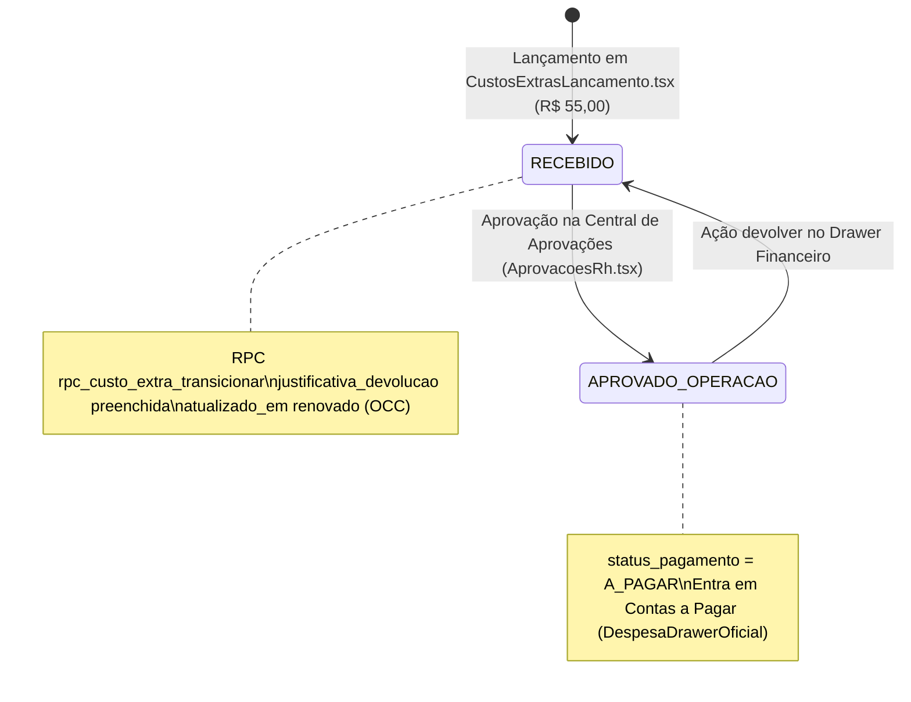

# ERP ORBE — FIX CEX-01
## GATE 5.7 — HOMOLOGAÇÃO BLACK BOX LOCAL
### ETAPA 1 — PRÉ-VOO E ISOLAMENTO

**Data:** 21 de Outubro de 2026  
**Ambiente:** Desenvolvimento Local / Supabase Oficial (`lifgjtcflzmspilhryap`)  
**Modo de Execução:** **READ-ONLY ESTRITO** (Nenhum dado criado, modificado ou deletado)  
**Status da Etapa:** **ETAPA 1 CONCLUÍDA — PARADA OBRIGATÓRIA PARA AVALIAÇÃO**  
**Parecer Técnico:** **GO AUTORIZADO PARA CRIAÇÃO DO REGISTRO SINTÉTICO (COM ESCLARECIMENTO DE PORTA E ORIGEM)**

---

## 1. RESULTADO DAS VERIFICAÇÕES DE PRÉ-VOO

### 1.1 Servidor Local de Desenvolvimento
- **Porta Efetiva:** O arquivo [vite.config.ts](file:///y:/2026/ERP%20ESC%20LOG/Orbe/vite.config.ts#L8-L13) configura explicitamente o servidor na porta **`8080`** (`host: "::", port: 8080`).
- **Status HTTP:** Teste de conexão local a `http://localhost:8080` retornou **`HTTP 200 OK`**.
- **Processo:** Processo Vite em execução contínua no terminal.
- **Hot Module Replacement (HMR):** Ativo e servindo os arquivos locais corrigidos:
  - `src/pages/Financeiro/components/DespesaDrawerOficial.tsx` (ação canônica `'devolver'`)
  - `src/pages/Rh/AprovacoesRh.tsx` (eliminação do UPDATE direto; uso da RPC com justificativa e OCC)
- **Instrução ao Operador:** Acessar a aplicação através de **`http://localhost:8080`** (em vez de 5173).

### 1.2 Conexão com o Supabase e Mecanismo de Isolamento
- **Projeto Supabase Conectado:** `lifgjtcflzmspilhryap.supabase.co` (Oficial).
- **Mecanismo de Segregação:** Gerenciado por [EnvironmentService.ts](file:///y:/2026/ERP%20ESC%20LOG/Orbe/src/services/environment/EnvironmentService.ts#L33-L41):
  - Chave no LocalStorage: `localStorage.getItem('esc-log-environment')`.
  - Modo Requerido para o Teste: **`'HOMOLOGACAO'`**.
  - No modo `'HOMOLOGACAO'`, o sistema filtra exclusivamente empresas com `is_teste = true`.
- **Empresa Autorizada:**
  - **Razão Social:** `Empresa Teste - Homologação`
  - **UUID:** `28a560b5-37ef-403d-ae4f-b28a608b6a68`
  - **Flag:** `is_teste = true`

---

## 2. CAMINHO EXATO NA INTERFACE LOCAL

Para a execução do teste ponta a ponta em `http://localhost:8080`:

| Etapa | Tela | Rota Local | Perfil / Ação |
| :--- | :--- | :--- | :--- |
| **1. Lançamento** | Portal do Encarregado / Lançamento de Custos Extras | `http://localhost:8080/custos-extras/novo`<br>*(ou `/producao/custos-extras`)* | Encarregado / Admin: Preencher os dados do registro sintético e salvar. |
| **2. Triagem RH** | Central de Aprovações RH | `http://localhost:8080/rh/aprovacoes` | RH / Admin: Selecionar pílula **"Custo Extra"** no modo Homologação. Validar indicador e abrir o Drawer. |
| **3. Contas a Pagar** | Central Financeira / Despesas | `http://localhost:8080/financeiro/despesas` | Financeiro / Admin: Visualizar a obrigação a pagar gerada após aprovação. |
| **4. Devolução** | Drawer Financeiro Oficial | Abrir despesa em `/financeiro/despesas` | Clicar em **"Devolver"**, preencher a justificativa e confirmar. |

---

## 3. DEFINIÇÃO TÉCNICA DO REGISTRO SINTÉTICO

### 3.1 Análise Crítica: `PAGO_EMPRESA` vs `PAGAMENTO_PENDENTE`

O planejamento solicitou verificar a compatibilidade de `PAGO_EMPRESA` com as regras de devolução:

> ⚠️ **CONSTATAÇÃO ARQUITETURAL FUNDAMENTAL:**
> 
> 1. No código canônico da RPC [rpc_custo_extra_transicionar](file:///y:/2026/ERP%20ESC%20LOG/Orbe/supabase/migrations/20260918130000_fase1_custos_extras_origem_recurso_rpc.sql#L241-L245):
>    - Se `origem_recurso = 'PAGO_EMPRESA'`, ao ser aprovado o registro torna-se imediatamente **`FINALIZADO`** e **`PAGO`** (pois foi desembolsado diretamente pela empresa).
>    - Nas linhas 313 e 318 da RPC, a ação `devolver` **PROÍBE categoricamente** devolução de registros `FINALIZADO` ou `PAGO`:
>      ```sql
>      IF v_registro.pipeline_status = 'FINALIZADO' THEN
>          RAISE EXCEPTION 'Estado FINALIZADO é terminal e não permite devolução pela ação padrão.';
>      END IF;
>      IF v_registro.status_pagamento = 'PAGO' THEN
>          RAISE EXCEPTION 'Ação não permitida: despesa com status de pagamento PAGO não pode ser devolvida à operação...';
>      END IF;
>      ```
> 2. Além disso, na linha 322 da RPC:
>    ```sql
>    IF v_registro.pipeline_status NOT IN ('EM_VALIDACAO', 'APROVADO_OPERACAO', 'ENVIADO_FINANCEIRO') THEN
>        RAISE EXCEPTION 'Estado atual (%) não permite devolução.', v_registro.pipeline_status;
>    END IF;
>    ```
>    Um registro recém-criado em `RECEBIDO` não pode sofrer devolução antes de ser avançado para validação ou aprovado operacionalmente.
> 3. Por outro lado, com **`origem_recurso = 'PAGAMENTO_PENDENTE'`** (ou `REEMBOLSO_COLABORADOR`):
>    - A aprovação operacional transiciona para **`APROVADO_OPERACAO`** e **`A_PAGAR`**.
>    - O registro entra no Contas a Pagar (`DespesaDrawerOficial.tsx`).
>    - A ação `devolver` é **100% permitida**, executando com perfeição o teste da correção feita no Drawer Financeiro!

### 3.2 Cenário Sintético Recomendado

Para testar de forma completa e íntegra o fluxo corrigido no FIX CEX-01:

- **Tipo:** Custo Extra
- **Empresa:** `Empresa Teste - Homologação` (ID: `28a560b5-37ef-403d-ae4f-b28a608b6a68`)
- **Categoria:** `Custo Operacional` (ex: Consumíveis / Operação)
- **Descrição:** `HML CEX-01 — Teste Sintético de Devolução`
- **Quantidade:** 1
- **Valor Unitário / Total:** **`R$ 55,00`** *(valor exclusivo, facilmente distinguível dos 380, 150 e 85 homologados)*
- **Origem do Recurso:** **`PAGAMENTO_PENDENTE`** *(compatível com o Contas a Pagar e com a ação `devolver` no Drawer)*
- **Favorecido:** Fornecedor cadastrado na empresa de teste
- **Forma de Pagamento:** Boleto / Transferência / Dinheiro
- **Justificativa de Devolução (no momento da devolução):**  
  `HML FIX CEX-01 — Devolução para validação do fluxo de aprovação`

---

## 4. ESTADOS ESPERADOS DO CICLO DE VIDA



| Momento | `pipeline_status` | `status_pagamento` | `situacao` na View | Onde deve aparecer? |
| :--- | :--- | :--- | :--- | :--- |
| **Após Criação** | `RECEBIDO` | `A_PAGAR` | `'Em análise'` | Central de Aprovações (Aguardando Decisão = 1) |
| **Após Aprovação RH** | `APROVADO_OPERACAO` | `A_PAGAR` | `'Aprovado'` | Sai da fila RH (Inbox Zero); entra em Despesas/Contas a Pagar |
| **Após Devolução** | `RECEBIDO` | `A_PAGAR` | `'Em análise'` / Histórico | Sai de Contas a Pagar; retorna à fila com justificativa gravada |

---

## 5. CONSULTAS SQL DE LINHA DE BASE (CONFERÊNCIA READ-ONLY)

### 5.1 Linha de Base dos 4 Registros Homologados (Congelada)
Consulta executada contra o Supabase oficial confirmou os registros protegidos:

```sql
SELECT 
    id, 
    data, 
    descricao, 
    total, 
    origem_recurso, 
    pipeline_status, 
    status_pagamento, 
    atualizado_em
FROM public.custos_extras_operacionais
WHERE empresa_id = '28a560b5-37ef-403d-ae4f-b28a608b6a68'
  AND deleted_at IS NULL
ORDER BY total DESC;
```

**Resultado Oficial Confirmado:**
1. `f6c3685e-c17e-460b-8797-37ec2f327a7d` — R$ 380,00 | `PAGAMENTO_PENDENTE` | `APROVADO_OPERACAO` | `A_PAGAR`
2. `98c5defd-0e75-4ef5-b510-7b8e83045bc6` — R$ 380,00 | `PAGAMENTO_PENDENTE` | `APROVADO_OPERACAO` | `A_PAGAR`
3. `1837369f-f460-4d6d-add0-73a34e8079c4` — R$ 150,00 | `PAGO_EMPRESA`        | `FINALIZADO`        | `PAGO`
4. `c1aa8f36-6c75-4ed3-998e-f897b8a09e35` — R$  85,00 | `REEMBOLSO_COLABORADOR`| `APROVADO_OPERACAO` | `A_PAGAR`

- **Total Histórico Protegido:** R$ 995,00
- **Contas a Pagar Protegido:** R$ 845,00
- **Pagamentos Realizados:** R$ 150,00

### 5.2 Consulta para Acompanhamento do Registro Sintético
```sql
SELECT 
    id, 
    descricao, 
    total, 
    origem_recurso, 
    pipeline_status, 
    status_pagamento, 
    justificativa_devolucao,
    atualizado_em
FROM public.custos_extras_operacionais
WHERE empresa_id = '28a560b5-37ef-403d-ae4f-b28a608b6a68'
  AND descricao = 'HML CEX-01 — Teste Sintético de Devolução'
  AND deleted_at IS NULL;
```

---

## 6. CRITÉRIOS DE GO / NO-GO

| Critério de Pré-Voo | Status | Evidência Técnica |
| :--- | :---: | :--- |
| **Servidor Vite Ativo** | ✅ GO | Porta `8080` ativa e respondendo `HTTP 200`. HMR ativo. |
| **Frontend com Correções** | ✅ GO | `DespesaDrawerOficial.tsx` (`'devolver'`) e `AprovacoesRh.tsx` (RPC canônica) validados. |
| **Isolamento de Ambiente** | ✅ GO | `EnvironmentService` suporta `'HOMOLOGACAO'`. Empresa de teste identificada (`is_teste = true`). |
| **Linha de Base Congelada** | ✅ GO | 4 registros mapeados; IDs congelados; total de R$ 995,00 preservado. |
| **Regras da RPC Mapeadas** | ✅ GO | Comprovado que `PAGAMENTO_PENDENTE` permite devolução e que `FINALIZADO`/`PAGO` bloqueia. |
| **Risco aos Dados Existentes** | ✅ GO | Risco nulo: registro sintético com valor de R$ 55,00 isolado na empresa de teste. |

---

## 7. PARECER CONCLUSIVO — ETAPA 1

> ### **PARECER TÉCNICO: GO AUTORIZADO PARA CRIAÇÃO DO REGISTRO SINTÉTICO**
> 
> O pré-voo técnico foi concluído com êxito. O ambiente local está estável, o servidor Vite em `http://localhost:8080` está ativo com as correções locais, o banco Supabase oficial está conectado e a linha de base de R$ 995,00 está protegida.
> 
> Recomenda-se utilizar a origem de recurso **`PAGAMENTO_PENDENTE`** para permitir a validação integral da devolução via Drawer Financeiro Oficial.

---

## 🛑 PARADA OBRIGATÓRIA NO GATE 5.7 (ETAPA 1)

Em estrito cumprimento às instruções da ordem de serviço:
> **RESTRIÇÕES ABSOLUTAS:**  
> - Não criar registros nesta etapa.  
> - Não executar transições.  
> - Não modificar dados no Supabase.  
> - Não alterar código ou configurações.  
>  
> **PARAR APÓS A ETAPA 1.**  
> Aguardar autorização expressa do usuário para iniciar a criação manual do registro sintético.
