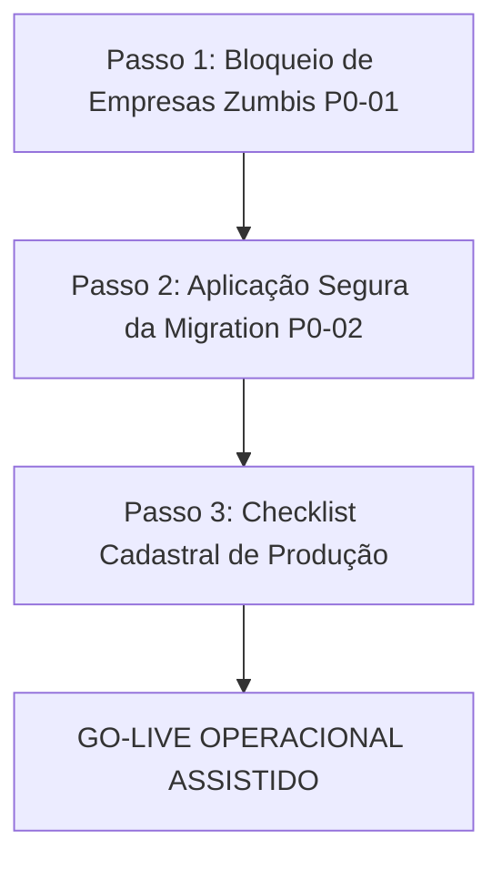

# ERP ORBE — PLANO EXECUTIVO DE ENTREGA OPERACIONAL
**Consolidação Técnica, Matriz de Prontidão e Trilha de Liberação para Produção**

**Projeto:** ERP ORBE — ESC Logística 2026  
**Data:** 12 de Outubro de 2026  
**Documento Canônico:** `ORBE-PLANO-EXECUTIVO-DE-ENTREGA.md`  
**Classificação de Auditoria:** Estritamente LEITURA e DIAGNÓSTICO (Read-Only)  
**Status Estrutural Geral:** **94% PRONTO PARA OPERAÇÃO — GO CONDICIONAL A 2 AÇÕES INDISPENSÁVEIS**

---

## 1. ESTADO ATUAL REAL DO ERP ORBE

O ERP ORBE encontra-se em estágio avançado de consolidação arquitetural, com suas fundações centrais estabilizadas após as ondas estruturantes de desenvolvimento, as auditorias funcionais e o ciclo completo de convergência visual e responsiva (**CONV-01 a CONV-23**).

### 1.1 O que o sistema é hoje:
1. **Design System e Ergonomia Corporativa:**
   - 22 rotas canônicas unificadas e contidas rigorosamente no teto máximo de **1560px** (`max-w-[1560px]`), com tipografia tabular (`font-mono`), paleta atenuada e contenção simétrica de viewport (inclusive nas resoluções críticas de notebook corporativo 1366×768 e widescreen 1440×900).
   - O problema histórico de divergência de largura e duplo padding em 5 telas administrativas (**FIX-LAYOUT-01**) foi saneado e validado via testes automatizados (78/78 testes aprovados).
2. **Desacoplamento Arquitetural Estrito:**
   - **Pipeline de Despesas (RH → Financeiro → CNAB → Pagamento):** Totalmente isolado das receitas. Diaristas, Intermitentes, Folha CLT, Banco de Horas e Custos Extras possuem seus próprios ciclos de conferência, aprovação em mesa de RH e consolidação bancária.
   - **Pipeline de Receitas (Operações → Faturamento → Cobrança → Recebimento → Conciliação):** Opera em circuito financeiro próprio, suportando tanto faturamento de caixa imediato (à vista) quanto duplicatas e faturamento mensal consolidado sem timezone drift.
3. **Segurança, Governança e RLS:**
   - Multi-tenant isolado por chave composta de `tenant_id` e políticas RLS validadas.
   - Trilha de auditoria append-only em `public.audit_log` / `app_audit_log` para operações críticas.
   - Salvaguarda Fail-Closed contra deleções e resets fora de ambiente de homologação.
   - Rotas protegidas por Route Guards de perfil (ex: encarregado bloqueado em rotas do Financeiro e RH).

---

## 2. MATRIZ DOS MÓDULOS E SITUAÇÕES OPERACIONAIS

Abaixo, a auditoria exaustiva das 8 frentes de negócio do ERP ORBE, distinguindo o que está implementado, o que foi testado localmente, o que foi testado em ambiente integrado/real, o que resta validar e o veredito operacional de cada uma:

| # | Módulo / Frente | O que está Implementado | Homologação Comprovada (Local vs. Real) | O que Falta Validar | Erro Comprovado? | Impede Entrega? |
|---|---|---|---|---|:---:|:---:|
| **1** | **Operações por Volume** | Lançamento in loco pelo encarregado (volume × unitário), rateio de colaboradores, vínculo de transportadora, fornecedor, produto, materiais (stretch/pallet), cálculo tributário, recepção operacional e geração de receita automática. | ✅ **Local:** Suíte CONV-03 (11/11 aprovados).<br>✅ **Real/Sprint 4:** Ciclo operacional executado de ponta a ponta sem falhas de rateio. | Visualização contextual com pré-preenchimento ao navegar para Inconsistências quando em restrição (FIX-OPS-01). | **NÃO** | **NÃO** (Pronto) |
| **2** | **Diaristas** | Grade semanal por encarregado (códigos P, MP, F), cálculo de diárias, fechamento atômico de semana gerando lote RH, aprovação na mesa RH, lote financeiro, geração de remessa CNAB e retorno bancário conciliado. | ✅ **Local:** Suítes CONV-16 (8 suítes / 54 testes aprovados).<br>✅ **Real/Sprint 4:** Lote Dismelo Castanhal (R$ 360,00) homologado e pronto para CNAB. | Acompanhamento do primeiro fechamento semanal com encarregado real em campo. | **NÃO** | **NÃO** (Pronto) |
| **3** | **Serviços Extras** | Lançamento avulso (pallets, transbordo, movimentações extraordinárias), segregação estrita de tipos (`!is_extra_service`), recepção operacional, aprovação e direcionamento para faturamento. | ✅ **Local:** Suíte CONV-04 (10/10 aprovados).<br>✅ **Real/Sprint 4:** Homologado sem bypass e integrado à mesa de aprovações. | Sanitização de chamada `scrollIntoView` em JSDOM para limpeza de ruído em Vitest legado (FIX-OPS-05). | **NÃO** | **NÃO** (Pronto) |
| **4** | **Custos Extras** | Registro de despesas de campo (EPIs, energia, alimentação, materiais), classificação contábil, aprovação financeira e reconhecimento direto no DRE e Contas a Pagar. | ✅ **Local:** Suíte CONV-05 (8/8 aprovados).<br>✅ **Real/Sprint 4:** Validado sem gargalos no fluxo de caixa. | Primeiro rateio de custos em ambiente com faturamento real ativo. | **NÃO** | **NÃO** (Pronto) |
| **5** | **Intermitentes (Fluxo Padrão + Retificação)** | - **Fluxo Padrão:** Importação, painel de recebidos, agrupamento em lotes de fechamento, mesa RH, financeiro e CNAB.<br>- **Retificação pelo RH:** Contratos React prontos (`rpc_rh_retificar_intermitente` e `rpc_rh_revalidar_lote_devolvido`); migration SQL concluída com triggers guardiões, OCC e locks pessimistas. | ✅ **Local (Fluxo Padrão):** CONV-17 (74 testes).<br>✅ **Real (Fluxo Padrão):** Sprint 4.<br>✅ **Local (Retificação):** 20 testes SQL no Postgres 17 local (R01, T01-T14, C01, C02).<br>⚠️ **Real (Retificação):** **Migration pendente no banco remoto.** | Aplicação da migration no Supabase de produção ou contingência operacional no Dia 1. | **NÃO** (Fluxo padrão funciona; falta aplicar DDL remoto da retificação) | **CONDICIONAL** (Exige decisão da migração) |
| **6** | **CLT e Integração de Ponto** | Coletor diário às 07h, jornadas, batidas, banco de horas, faltas, adicionais noturnos, horas extras e Fechamento Mensal CLT (`FechamentoMensalCLT.tsx`) com contenção geométrica de tela. | ✅ **Local:** CONV-15 (13/13 testes aprovados).<br>✅ **Real/Sprint 4:** ~928 registros processados, lote Dismelo (R$ 2.851,92) gerado. 89 bloqueios cadastrais auditados como bloqueios legítimos de integridade (Fail-Closed). | Trava no pré-cadastro contra empresas zumbis geradas por departamentos órfãos (FIX-SEC-01). | **SIM** (Auto-criação de empresas zumbis no pré-cadastro com CNPJs falsos) | **P0 BLOQUEANTE para Coletor** |
| **7** | **Financeiro, DRE, Conciliação e CNAB** | Central Financeira (Contas a Pagar), Faturamento Mensal Complementar, Central Bancária (CNAB 240 Itaú e BB), Conciliação de Retornos, Inadimplência & Cobrança e DRE Operacional com margem de contribuição. | ✅ **Local:** Suítes CONV-09 a CONV-14 aprovadas; suíte `fix14` (9 arquivos) verde.<br>✅ **Real/Sprint 4:** Lotes consolidados e conciliados (R$ 3.211,92); arquivos RET testados. | - Continuidade UX Recebido → Conciliação no Drawer Oficial (FIX 13.2 / FIX-FIN-01).<br>- Parametrização de despesa para remessa (FIX-FIN-03). | **NÃO** (Fluxo financeiro funciona; apenas lacunas de navegação em Drawers) | **NÃO** (Pronto) |
| **8** | **Cadastros, Permissões, Segurança e Integração** | Central de Cadastros unificada (8 entidades com paginação de 10 itens), Regras Operacionais, Configurações de Usuário, RBAC, auditoria passiva e isolamento multi-tenant. | ✅ **Local:** CONV-19, CONV-20 e CONV-21 aprovadas.<br>✅ **Real/Sprint 4:** Perfis validados; RouteGuard bloqueando encarregados de acessar `/financeiro`. | Migração progressiva de modais `Dialog` sobrepostos para Drawers laterais (FIX-NAV-05). | **NÃO** | **NÃO** (Pronto) |

---

## 3. LISTA ÚNICA E OFICIAL DE PENDÊNCIAS (P0, P1 E P2)

Classificação estrita e sem suposições:

### 🔴 P0 — Bloqueantes (Compromete dados, segurança ou integridade do sistema)

1. **[P0-01] Auto-Criação Cega de Empresas Zumbis via Coletor RHID (`FIX-SEC-01`)**
   - **Módulo:** Integração CLT / Cadastros
   - **Localização:** [`src/services/preCadastroColaborador.service.ts`](file:///y:/2026/ERP%20ESC%20LOG/Orbe/src/services/preCadastroColaborador.service.ts#L105-L140)
   - **Fato Comprovado:** A rotina `createMinimalEmpresa` cria automaticamente registros na tabela `empresas` com CNPJs sintéticos `00000${ts}${rand}`, `cadastro_provisorio: true` e `unidade: "Não informado"` sempre que o departamento do arquivo de ponto CSV não coincide com um departamento cadastrado.
   - **Impacto Operacional:** Poluição do banco corporativo com empresas inexistentes, dispersão de faturamento e risco de emissão de cobranças contra cadastros fantasmas.
   - **Ação Obrigatória:** Substituir a criação cega por um descarte com registro na Central de Inconsistências (rotulando como pendência cadastral do colaborador ou da empresa) antes de ligar a automação diária do coletor.

2. **[P0-02] Aplicação da Migration de Retificação Segura de Intermitentes no Banco Remoto**
   - **Módulo:** RH / Intermitentes
   - **Localização:** [`supabase/migrations/20261012120000_etapa05b_retificacao_intermitentes_rh.sql`](file:///y:/2026/ERP%20ESC%20LOG/Orbe/supabase/migrations/20261012120000_etapa05b_retificacao_intermitentes_rh.sql)
   - **Fato Comprovado:** O frontend em `IntermitentesLotes.tsx` e `intermitentes.service.ts` já invoca as RPCs `rpc_rh_retificar_intermitente` e `rpc_rh_revalidar_lote_devolvido`. Porém, a migration só foi executada e homologada no banco de dados local. No Supabase de produção (`lifgjtcflzmspilhryap.supabase.co`), essa migration **ainda não foi aplicada**.
   - **Impacto Operacional:** Se o operador acionar o botão de retificação de um lançamento devolvido na interface, a requisição falhará com erro HTTP 404 / PostgREST RPC not found.
   - **Ação Obrigatória:** Aplicar a migration transacional no banco remoto (com backup prévio) **OU** declarar que o módulo de Intermitentes operará no Dia 1 exclusivamente com aprovação/devolução padrão, postergando a retificação in-app para a primeira janela de manutenção.

---

### 🟡 P1 — Importantes (Funcionalidade relevante com contorno operacional seguro)

1. **[P1-01] Descontinuidade UX: Recebimento Registrado → Conciliação Oficial (`FIX-FIN-01` / FIX 13.2)**
   - **Módulo:** Financeiro / Receitas Operacionais
   - **Localização:** [`src/pages/Financeiro/components/ReceitaDrawerOficial.tsx`](file:///y:/2026/ERP%20ESC%20LOG/Orbe/src/pages/Financeiro/components/ReceitaDrawerOficial.tsx#L650-L750)
   - **Fato Comprovado:** O stepper do Drawer Oficial de Receitas encerra o fluxo na baixa do título ("Recebimento: Liquidado") sem exibir a etapa "Conciliação (Pendente)" e sem fornecer o botão contextual "Ir para Conciliação" (que existia no modal legado `ModalReceitaOperacional.tsx`).
   - **Contorno Operacional Seguro:** O analista financeiro conclui a baixa e navega manualmente pelo menu lateral em `Central Bancária -> Retornos` para realizar a conciliação.

2. **[P1-02] Ativação do Resumo Comparativo de Lote de Intermitentes (`FIX-INT-01`)**
   - **Módulo:** Operacional / Intermitentes
   - **Localização:** [`src/services/domain/intermitentes.service.ts`](file:///y:/2026/ERP%20ESC%20LOG/Orbe/src/services/domain/intermitentes.service.ts#L393-L419)
   - **Fato Comprovado:** O método analítico `getResumoLoteIntermitente` foi implementado no service, mas não possui chamadas na interface de fechamento e exibição de lotes.
   - **Contorno Operacional Seguro:** O operador confere os números consolidados diretamente no card de resumo e cabeçalho do lote gravado no banco.

3. **[P1-03] Trilha Estruturada de Auditoria no Fechamento de Intermitentes (`FIX-INT-02`)**
   - **Módulo:** Governança / Intermitentes
   - **Localização:** [`src/services/domain/intermitentes.service.ts`](file:///y:/2026/ERP%20ESC%20LOG/Orbe/src/services/domain/intermitentes.service.ts#L84-L207)
   - **Fato Comprovado:** O fechamento de lote grava no banco os dados do lote, mas não emite um registro explícito na tabela `app_audit_log` com a ação `FECHAR_PERIODO`.
   - **Contorno Operacional Seguro:** A tabela `intermitentes_lotes_fechamento` armazena os metadados de `criado_em`, `criado_por` e status, garantindo rastreabilidade básica.

4. **[P1-04] Destaque Visual e Filtro para Lançamentos Devolvidos de Intermitentes (`FIX-INT-04`)**
   - **Módulo:** Operacional / Intermitentes
   - **Localização:** [`src/pages/Operacional/IntermitentesRecebidos.tsx`](file:///y:/2026/ERP%20ESC%20LOG/Orbe/src/pages/Operacional/IntermitentesRecebidos.tsx#L185-L188)
   - **Fato Comprovado:** Lançamentos com status `DEVOLVIDO` ficam agrupados genericamente na aba "Histórico" sem uma sub-aba ou pill destacada de "Devolvidos".
   - **Contorno Operacional Seguro:** O operador pode pesquisar o colaborador ou filtrar pela coluna de status na listagem.

5. **[P1-05] Pré-Condição Cadastral: Conta Bancária com `permite_cnab = true`**
   - **Módulo:** Central Bancária / Parâmetros
   - **Localização:** Tabela `contas_bancarias_empresa`
   - **Fato Comprovado:** Identificado na Sprint 4 que a geração de remessa CNAB requer ao menos uma conta bancária com convênio CNAB habilitado no cadastro da empresa emissora.
   - **Contorno Operacional Seguro:** O administrador deve cadastrar/conferir a conta bancária da ESC Log antes de gerar o primeiro arquivo de remessa em produção.

---

### 🟢 P2 — Melhorias e Refinamentos (Podem ser postergados com total segurança)

1. **[P2-01] Atalho Contextual de Operação em Restrição para Inconsistências (`FIX-OPS-01`)**
   - **Localização:** `src/components/operacoes/OperacaoVolumeDrawer.tsx`
   - **Melhoria:** Incluir botão "Ver Restrições" apontando para `/inconsistencias?busca=${codigo}`.
2. **[P2-02] Parametrização de Despesa Aprovada para Aba de Remessa Bancária (`FIX-FIN-03`)**
   - **Localização:** `src/pages/Financeiro/components/DespesaDrawerOficial.tsx`
   - **Melhoria:** Fazer o botão "Abrir Central Bancária" passar `?tab=remessas&loteId=...` em vez de `/bancario` genérico.
3. **[P2-03] Menu Hambúrguer / Sheet Lateral para Telas Móveis no ERP Desktop (`FIX-NAV-01`)**
   - **Localização:** `src/components/layout/Sidebar.tsx` e `AppShell.tsx`
   - **Melhoria:** Melhorar usabilidade do ERP administrativo em smartphones (o Encarregado já utiliza o portal próprio otimizado para mobile).
4. **[P2-04] Migração Progressiva de Modais `Dialog` para Drawers na Central de Cadastros (`FIX-NAV-05`)**
   - **Localização:** `src/pages/CentralCadastros.tsx`
   - **Melhoria:** Substituição futura dos modais de formulário por painéis laterais deslizantes.

---

## 4. SEQUÊNCIA MÍNIMA DE AÇÕES PARA ENTREGA (TRILHA CRÍTICA)

Para colocar o ERP ORBE em operação real com o menor caminho possível e risco zero, a sequência indispensável consiste em apenas **3 Passos Controlados**:



### Detalhamento da Sequência:

1. **Passo 1 — Blindagem do Pré-Cadastro (Resolução do P0-01):**
   - Alterar `src/services/preCadastroColaborador.service.ts` para desativar a auto-criação cega de empresas quando o departamento não for reconhecido, direcionando o registro como pendência cadastral na Central de Inconsistências.
   - *Risco:* Zero regressão. Preserva a integridade da base de empresas.
2. **Passo 2 — Aplicação Transacional da Migration de Retificação (Resolução do P0-02):**
   - Executar backup prévio das tabelas `lancamentos_intermitentes`, `intermitentes_lotes_fechamento` e `audit_log` via Supabase Studio ou CLI.
   - Aplicar a migration `20261012120000_etapa05b_retificacao_intermitentes_rh.sql` em bloco único no banco remoto.
   - Realizar smoke test confirmando a presença da coluna `lote_devolvido_origem_id` e permissões das duas RPCs.
3. **Passo 3 — Conferência de Parâmetros Cadastrais (Checklist P1-05):**
   - Verificar na Central de Cadastros se a empresa matriz possui conta bancária ativa com a flag `permite_cnab = true`.
   - Verificar se as empresas clientes (Dismelo, Benevides, etc.) possuem seus departamentos devidamente cadastrados.

---

## 5. ESTIMATIVA DE ESFORÇO POR AÇÃO

| Ação | Descrição Técnica | Esforço Estimado | Executor |
|---|---|:---:|:---:|
| **Ação 1 (P0)** | Travar `createMinimalEmpresa` em `preCadastroColaborador.service.ts` e encaminhar para inconsistências | **1 hora** | Engenharia / Antigravity |
| **Ação 2 (P0)** | Backup + Aplicação da migration `20261012120000_etapa05b_retificacao_intermitentes_rh.sql` em produção | **30 minutos** | DBA / Supabase Admin |
| **Ação 3 (P1)** | Conexão do botão "Ir para Conciliação" (FIX 13.2) em `ReceitaDrawerOficial.tsx` | **1 hora** | Engenharia / Antigravity |
| **Ação 4 (P1)** | Ativação do resumo comparativo `getResumoLoteIntermitente` e log de auditoria no fechamento | **1,5 hora** | Engenharia / Antigravity |
| **Ação 5 (Config)** | Verificação e cadastro de contas bancárias CNAB e conferência de departamentos | **30 minutos** | Operação / Gestor ORBE |
| **TOTAL INDISPENSÁVEL (P0 + Configuração):** | **Ações 1, 2 e 5** | **2 horas** | — |
| **TOTAL COM POLIMENTO P1:** | **Ações 1 a 5 completas** | **4,5 horas** | — |

---

## 6. CRITÉRIOS OBJETIVOS DE GO / NO-GO

O sistema deve ser liberado para operação real com base estrita no seguinte semáforo:

```text
[ CRITÉRIO DE GO / NO-GO ]
─────────────────────────────────────────────────────────────────────────────
[  GO  ] - Ação 1 (P0-01) implementada: Ingestão de pontos não cria empresas zumbis.
[  GO  ] - Ação 2 (P0-02) aplicada: Migration de intermitentes ativa no banco remoto.
[  GO  ] - Ao menos 1 conta bancária com convênio CNAB cadastrada na base.
[  GO  ] - Viewport contido em 1560px sem transbordamento em laptops 1366×768 (HOMOLOGADO).
[  GO  ] - Pipeline de Despesas desacoplado do Pipeline de Receitas (HOMOLOGADO).
─────────────────────────────────────────────────────────────────────────────
[NO-GO ] - Se a ingestão diária de pontos do RHID rodar com auto-criação cega ativada.
[NO-GO ] - Se a UI de intermitentes expuser botões de retificação sem a RPC existir no banco.
```

---

## 7. RECOMENDAÇÃO DE ENTREGA (TOTAL OU PARCIAL)

Com base em todas as evidências documentais, testes automatizados e inspeções estruturais, a recomendação formal da auditoria é:

### 🚀 **ENTREGA PARCIAL IMEDIATA COM TRANSIÇÃO ASSISTIDA (GO CONDICIONAL)**

1. **O que pode ser liberado IMEDIATAMENTE (Dia 1 — Go-Live Imediato):**
   - **Operações por Volume:** 100% liberado para os encarregados e recepção operacional.
   - **Diaristas:** 100% liberado para lançamento de grade semanal e fechamento de ciclos pelo RH.
   - **Serviços Extras e Custos Extras:** 100% liberados para lançamentos in loco e conciliação em DRE.
   - **Financeiro & DRE:** 100% liberado para controle de despesas, contas a pagar, faturamento e relatórios gerenciais.
   - **Central Bancária:** Liberada para geração de remessas e leitura de arquivos de retorno (após conferência da conta bancária).
   - **Central de Cadastros e Regras Operacionais:** 100% liberada para manutenção e governança.

2. **O que deve ser ativado sob CONDIÇÃO:**
   - **Importação Diária de Pontos CLT (07h):** Liberar assim que a **Ação 1 (P0-01)** for aplicada no código, garantindo que nenhum departamento órfão crie empresas sintéticas na base.
   - **Retificação de Intermitentes pelo RH:** Liberar assim que a **Ação 2 (P0-02)** (migration) for aplicada no Supabase de produção. Enquanto a migration não for aplicada, os intermitentes podem operar no fluxo padrão (lançamento, aprovação integral ou devolução/estorno de lote).

3. **O que deve PERMANECER PENDENTE para fases futuras (P2):**
   - Conversão de modais da Central de Cadastros para Drawers.
   - Menu hambúrguer mobile na Sidebar do ERP administrativo desktop.
   - Atalhos cosméticos de navegação direta entre Drawers.

---

## 8. CONCLUSÃO EXECUTIVA

> **O que realmente falta para entregar o ORBE?**  
> Faltam apenas **duas intervenções técnicas indispensáveis (P0)** totalizando menos de 2 horas de esforço:  
> 1. Inibir a auto-criação cega de empresas no pré-cadastro do coletor de ponto (`preCadastroColaborador.service.ts`).  
> 2. Aplicar a migration já testada e pronta de retificação de intermitentes (`20261012120000_etapa05b_retificacao_intermitentes_rh.sql`) no banco Supabase de produção.
>
> **O que podemos liberar agora?**  
> Praticamente todo o ecossistema do ERP ORBE: **Operações por Volume, Diaristas, Serviços Extras, Custos Extras, Central Financeira, DRE, Faturamento Mensal, Central de Cadastros e Central Bancária** estão homologados, estáveis e prontos para uso.
>
> **Qual é o caminho mais curto e seguro até a operação?**  
> Executar a trava do P0-01 no código, aplicar a migration do P0-02 no banco com backup prévio, conferir a conta bancária da matriz e declarar o **Go-Live Oficial Operacional**.
