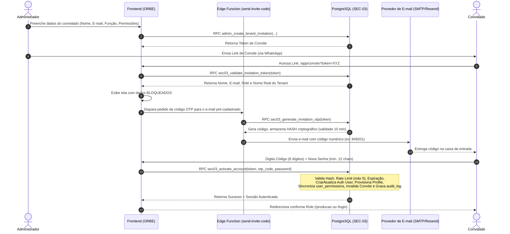

# ERP ORBE — SEC-03 | FASE 01: Auditoria Técnica e Planejamento de Onboarding Seguro
**Documento Oficial de Engenharia de Software, Segurança Multi-Tenant e Supabase Auth**  
**Data da Auditoria:** 30 de Outubro de 2026  
**Status do Gate:** **FASE 01 CONCLUÍDA — APENAS AUDITORIA E PLANEJAMENTO (IMPLEMENTAÇÃO BLOQUEADA)**  
**Autor:** Antigravity AI — Engenheiro Sênior & Auditor de Segurança

---

## 1. Resumo Executivo e Diagnóstico da Arquitetura Atual

A presente auditoria investigou minuciosamente o fluxo de convites e onboarding do ERP ORBE, percorrendo o código frontend (`Cadastro.tsx`, `Usuarios.tsx`, `App.tsx`), os componentes de controle de acesso (`AuthGuard`, `access-control.ts`), as RPCs de governança no PostgreSQL (`validate_invitation_token`, `accept_tenant_invitation`, `admin_create_tenant_invitation`), a infraestrutura de Edge Functions (`create-tenant`) e a integração com o Supabase Auth.

### 1.1 Diagnóstico Sintético da Situação Atual
1. **Canal Único e Risco de Interceptação de Link:**  
   O fluxo atual depende exclusivamente de um token transmitido na URL (`/cadastro?token=<TOKEN>`). Se o link for interceptado (em canais como WhatsApp, e-mail não criptografado ou logs de proxy), qualquer portador do link consegue ativar a conta e obter acesso ao tenant, sem comprovar posse da caixa postal de e-mail do destinatário.
2. **Exposição de Dados e Rótulos Genéricos:**  
   - O título na tela de aceite exibe literalmente `"Accept Invite"` (em inglês) porque está hardcoded na linha 273 de `Cadastro.tsx`.
   - O nome da empresa exibe o texto genérico `"Empresa"` (linha 86 de `Cadastro.tsx`) porque a RPC `validate_invitation_token` não realiza `JOIN` com a tabela `public.tenants` para obter a coluna `nome`.
   - A chamada pública `validate_invitation_token(p_token)` expõe imediatamente e-mail, nome pré-cadastrado, telefone, role e permissões antes de qualquer confirmação de identidade.
3. **Mutações Livres de Dados Cadastrais no Frontend:**  
   O formulário de cadastro permite ao convidado alterar o nome completo (`fullName`) que o Administrador pré-definiu. Embora o e-mail possua uma validação no frontend, os campos não são travados (read-only) com clareza institucional.
4. **Criação de Usuários Órfãos no Supabase Auth:**  
   Não existe atomicidade transacional entre o GoTrue (`auth.users`) e o PostgreSQL (`public.profiles`). O método `supabase.auth.signUp` cria o usuário em `auth.users` antes da chamada RPC `accept_tenant_invitation`. Caso ocorra erro de rede, concorrência, expiração ou validação na RPC, o usuário permanece criado em `auth.users`, mas sem perfil e sem tenant no ORBE, gerando um bloqueio permanente (*"User already registered"*) em novas tentativas.
5. **Autonomia Excessiva na Rota Aberta de Cadastro:**  
   A rota `/cadastro` sem token permitia que qualquer visitante anônimo criasse uma conta, um tenant e se tornasse `admin` via Edge Function `create-tenant`, violando a premissa de que o ORBE é um SaaS B2B corporativo fechado.

---

## 2. Matriz de Vulnerabilidades e Análise de Riscos (Arquitetura Atual)

| # | Pergunta / Cenário de Ataque | Avaliação / Evidência Técnica | Severidade |
|---|---|---|:---:|
| **V1** | **Uma pessoa que obtém somente o link consegue ativar a conta?** | **SIM.** O link contém o segredo completo (`token`). Como não há 2º fator (OTP via e-mail independente), quem tiver o link abre `/cadastro?token=...`, define uma senha qualquer e o `accept_tenant_invitation` aceita porque `auth.users.email` corresponde ao e-mail informado no `signUp`. | 🔴 **CRÍTICO** |
| **V2** | **Uma pessoa que obtém o link e altera o e-mail consegue se cadastrar?** | **NÃO.** O frontend bloqueia (`Cadastro.tsx:120`) e o backend valida estritamente (`accept_tenant_invitation`: `lower(invitation.email) <> lower((SELECT email FROM auth.users WHERE id = p_user_id))`). | 🟢 **BAIXO** |
| **V3** | **Um usuário consegue escolher outro tenant ou papel no convite?** | **NÃO.** No fluxo de convite, `accept_tenant_invitation` injeta diretamente `invitation.tenant_id` e `invitation.role` da tabela do banco. A SEC-02 já revogou `UPDATE` nessas colunas para clientes. | 🟢 **BAIXO** |
| **V4** | **Um convite renovado invalida imediatamente o link anterior?** | **SIM.** A RPC `admin_renew_tenant_invitation` sobrescreve a coluna `token` no banco com um novo hash criptográfico gerado via `extensions.gen_random_bytes(16)`, invalidando o token anterior no mesmo instante. | 🟢 **BAIXO** |
| **V5** | **Um convite excluído impede qualquer ativação posterior?** | **SIM.** A RPC `admin_delete_tenant_invitation` remove a linha fisicamente. Tentativas posteriores de chamar `validate_invitation_token` ou `accept_tenant_invitation` retornam `Convite inválido ou expirado`. | 🟢 **BAIXO** |
| **V6** | **O sistema permite criação de usuários órfãos no Supabase Auth?** | **SIM.** Como o `supabase.auth.signUp` é chamado antes da RPC `accept_tenant_invitation`, falhas intermediárias deixam o usuário persistido no GoTrue sem perfil correspondente no banco relacional. | 🟡 **ALTO** |
| **V7** | **Existem discrepâncias entre as regras do frontend e as do backend?** | **SIM.** O frontend exige senha de apenas 6 caracteres (`z.string().min(6)`), enquanto políticas corporativas exigem 12 caracteres. Além disso, o nome pré-cadastrado é sobrescrito pelo input do convidado sem consentimento do Admin. | 🟡 **MÉDIO** |
| **V8** | **Auto-criação de tenants aberta ao público (`create-tenant`)?** | **SIM.** O formulário de `/cadastro` sem convite instanciava tenants automáticos de teste, vulnerabilidade que deve ser bloqueada em favor de cadastros 100% assistidos. | 🟡 **ALTO** |

---

## 3. Investigação Específica das Inconsistências Visuais

### 3.1 Causa do Título "Accept Invite"
- **Arquivo:** `src/pages/Auth/Cadastro.tsx` (Linha 273)
- **Código Existente:**
  ```tsx
  const title = invitation ? "Accept Invite" : "Crie sua conta";
  ```
- **Diagnóstico:** String literal em inglês deixada durante a prototipação inicial.

### 3.2 Causa da Exibição Genérica de "Empresa"
- **Arquivo:** `src/pages/Auth/Cadastro.tsx` (Linha 86)
- **Código Existente:**
  ```tsx
  setInvitation({
    tenantId: inviteData.tenant_id,
    tenantName: "Empresa",
    role: inviteData.role,
    email: inviteData.email,
  });
  ```
- **Causa Raiz no Backend:** A RPC `validate_invitation_token(p_token)` (`20260524090000_admin_user_access_management.sql:428`) seleciona apenas colunas da tabela `tenant_invitations`:
  ```sql
  SELECT ti.id, ti.tenant_id, ti.email, ti.full_name, ti.phone, ti.role, ti.permissions, ti.expires_at, ...
  FROM public.tenant_invitations ti
  ```
  A função **não possui `JOIN` com `public.tenants`**, omitindo o campo `t.nome`. Como o frontend não recebia o nome fantasia da empresa contratante, utilizou o fallback fixo `"Empresa"`.

---

## 4. Avaliação Crítica do Mecanismo de 2º Fator (Código OTP de 6 Dígitos)

> ⚠️ **AVALIAÇÃO DE SEGURANÇA CRÍTICA:**  
> Um código de verificação enviado pelo **mesmo canal** do link de convite (ex.: ambos por e-mail ou ambos por WhatsApp) **NÃO oferece autenticação de dois fatores real**. Trata-se de uma redundância operacional que apenas adiciona atrito ao usuário.

### Modelo Aprovado de Dois Canais Independentes (2-Channel Onboarding):
1. **Canal 1 (Link de Acesso):** Enviado via **WhatsApp / Mensagem Direta** pelo Administrador ao colaborador. Contém o `token` imprevisível que abre a tela de ativação.
2. **Canal 2 (Código OTP de 6 Dígitos):** Disparado automaticamente pelo backend exclusivamente para o **E-mail Corporativo pré-cadastrado**.
3. **Garantia de Segurança:** Mesmo que o link do WhatsApp seja interceptado ou repassado indevidamente, o invasor **não conseguirá ativar a conta**, pois não tem acesso à caixa postal do e-mail oficial para obter o código de 6 dígitos.

---

## 5. Proposta de Arquitetura da SEC-03



### 5.1 Nova Estrutura de Dados Proposta

Recomenda-se criar uma tabela auxiliar desacoplada para o controle do OTP, mantendo `tenant_invitations` protegida:

```sql
CREATE TABLE public.tenant_invitation_otps (
    id UUID PRIMARY KEY DEFAULT gen_random_uuid(),
    invitation_id UUID NOT NULL REFERENCES public.tenant_invitations(id) ON DELETE CASCADE,
    code_hash TEXT NOT NULL,
    attempts INTEGER NOT NULL DEFAULT 0,
    max_attempts INTEGER NOT NULL DEFAULT 5,
    expires_at TIMESTAMPTZ NOT NULL DEFAULT (NOW() + INTERVAL '10 minutes'),
    verified_at TIMESTAMPTZ,
    created_at TIMESTAMPTZ NOT NULL DEFAULT NOW()
);

-- RLS estrita: Nenhuma leitura ou escrita para anon/authenticated direto
ALTER TABLE public.tenant_invitation_otps ENABLE ROW LEVEL SECURITY;
```

### 5.2 Segurança e Criptografia do Código OTP
- O código de 6 dígitos **nunca será gravado em texto plano**.
- Será armazenado como hash utilizando `extensions.crypt(p_code, extensions.gen_salt('bf'))` ou `sha256(p_code || invitation.id)`.
- **Rate Limiting Estrito:** Após 5 tentativas incorretas, o código é invalidado automaticamente, exigindo que o usuário solicite um novo código (com cooldown de 60 segundos entre reenvios).

### 5.3 Resolução da Atomicidade Transacional (Eliminação de Usuários Órfãos)
Para resolver a falha de consistência entre `auth.users` e o banco de dados:
- O cadastro será consolidado em uma **RPC com privilégios de sistema (`SECURITY DEFINER`)** ou orquestrado por uma **Edge Function segura de onboarding** que utiliza a Service Role exclusivamente no backend para executar uma transação de rollback em caso de falha de provisionamento do perfil:
  - Se a inserção em `public.profiles` falhar, o usuário criado em `auth.users` é removido imediatamente.
  - Se o usuário já possuir cadastro anterior, a função apenas vincula o tenant e atualiza as permissões aprovadas pelo convite, sem exigir que o usuário crie uma nova conta.

### 5.4 Preservação e Compatibilidade Operacional
- **Encarregados:** Continuam com fluxo de login e trabalho 100% segregados no portal mobile `/login/operacional` e `/producao`. O onboarding apenas pré-configura a role `'encarregado'`.
- **RH e Financeiro:** Recebem suas permissões granulares já pré-fixadas pelo Administrador no momento do convite, sendo direcionados para o ambiente web administrativo.
- **Bloqueio de Cadastro Aberto:** A rota `/cadastro` desprovida de token será desativada ou redirecionará permanentemente para `/login`, encerrando o auto-registro não supervisionado.

---

## 6. Plano de Implementação Incremental (Fases Futuras)

| Etapa | Escopo Técnico | Critério de Aceite | Reversibilidade |
|---|---|---|:---:|
| **Etapa 2.1 — Schema & RPCs** | Criação da tabela `tenant_invitation_otps`, atualização de `validate_invitation_token` (retornando `tenant_name`), e RPC `sec03_generate_invitation_otp`. | Teste isolado local: retorno do nome da empresa e geração de hash de OTP com expiração em 10 min. | Alta (DDL isolado) |
| **Etapa 2.2 — Serviço de Mensageria** | Edge Function `send-onboarding-otp` para disparo de e-mails transacionais (Resend / SMTP). | E-mail entregue com código de 6 dígitos em menos de 5 segundos. | Alta (Configuração de API) |
| **Etapa 2.3 — RPC de Ativação Segura** | Criação de `sec03_activate_account` com validação de OTP, rate limit de 5 tentativas, criação atômica de perfil e `audit_log`. | Teste de força bruta bloqueado na 5ª tentativa; aceite concorrente tratado com lock pessimista. | Alta (Function desacoplada) |
| **Etapa 2.4 — Redesenho da Interface** | Refatoração de `Cadastro.tsx` (`/app/convite`): remoção de "Accept Invite", dados bloqueados em modo leitura, input de OTP de 6 dígitos e política de senha (mín. 12 chars). | UX limpa, corporativa, em português, sem inputs livres de nome ou e-mail. | Média (Frontend) |
| **Etapa 2.5 — Homologação E2E & Transição** | Bateria completa de testes automatizados e manuais nos dois canais. Desativação do cadastro aberto sem token. | Homologação formal com 100% PASS antes de liberar convites reais de produção. | Total |

---

## 7. Recomendações e Parecer para a Fase Atual

1. **Recomendação Imediata:** **NÃO LIBERAR CONVITES REAIS DE PRODUÇÃO** sob o modelo atual de link único sem 2º fator. O risco de ativação indevida por interceptação de link é **CRÍTICO**.
2. **Correção Imediata de Baixo Risco no Frontend:** A substituição do texto `"Accept Invite"` por `"Ativação de Conta"` e a injeção do nome real da empresa podem ser preparadas na Etapa 2 sem impacto em dados existentes.
3. **Estado Atual:** Todas as diretrizes de não-intervenção foram estritamente cumpridas. Nenhum arquivo de produção foi alterado e nenhum dado foi violado.

---
**Documento Arquivado Oficialmente em:**  
[supabase/auditorias/SEC_03_FASE_01_AUDITORIA_ONBOARDING_SEGURO.md](file:///y:/2026/ERP%20ESC%20LOG/Orbe/supabase/auditorias/SEC_03_FASE_01_AUDITORIA_ONBOARDING_SEGURO.md)

**Aguardando sua autorização e orientações para o avanço para a FASE 02.**

