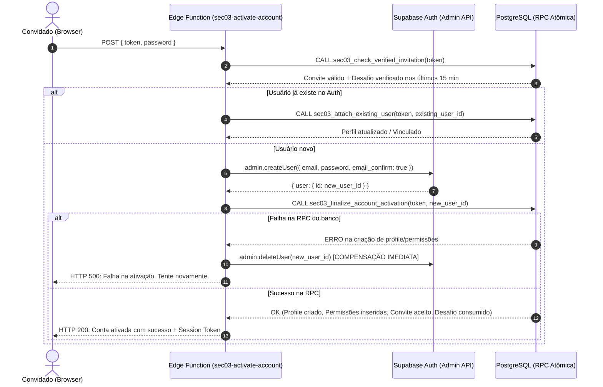

# ORBE — SEC-03 | RELATÓRIO TÉCNICO FASE 02.1: FUNDAÇÃO DE SEGURANÇA DO ONBOARDING

**Data:** 30/10/2026  
**Ambiente de Execução:** Local Isolado Docker (`supabase_db_sec02_hml:54322`, PostgreSQL 17)  
**Status do Deploy Cloud:** INTOCADO (Zero modificações no Supabase Cloud de produção)  
**Resultado da Homologação Automatizada:** 15/15 PASS (100% de conformidade com os critérios de segurança)  

---

## 1. RESUMO EXECUTIVO

Em atendimento ao plano traçado na **SEC-03 FASE 01**, a **FASE 02.1** implementou a fundação de segurança no banco de dados para suportar o novo fluxo de onboarding assistido do ERP ORBE.

Foram criadas estruturas para emissão, controle de taxa, expiração e validação criptográfica de desafios numéricos temporários (OTP de 6 dígitos), além da correção do enriquecimento dos dados do convite para exibição da razão social oficial do tenant (`tenants.nome`).

A implementação foi realizada de forma estritamente incremental na migration `supabase/migrations/20261030203000_sec_03_fase2_1_onboarding_otp_foundation.sql`, mantendo total retrocompatibilidade com as RPCs e políticas homologadas na SEC-02.

---

## 2. DIAGNÓSTICO E PRESERVAÇÃO DE CONTRATOS EXISTENTES

Antes da codificação, foi auditada a cadeia de dependências e os contratos atuais:

| Entidade / Função | Contrato Anterior | Impacto na FASE 02.1 | Preservação |
|---|---|---|---|
| `public.tenant_invitations` | Chave primária UUID, `tenant_id`, `email`, `role`, `token`, `status`, `expires_at` | Nenhuma coluna removida ou alterada. Adicionado trigger de invalidação em cascata de desafios pendentes quando o convite é aceito, bloqueado ou expirado. | **100% Preservado** |
| `public.validate_invitation_token` | Retornava metadados sem o nome da empresa (`tenant_name`) | Atualizada para incluir `JOIN public.tenants` retornando `tenant_name` oficial. Assinatura mantida e retrocompatível com o frontend atual. | **100% Preservado** |
| `public.profiles` | Políticas RLS e restrições colunares da SEC-02 | Nenhuma alteração. RLS bloqueando alteração de `role` e `tenant_id` continua ativa (erro 42501 mantido). | **100% Preservado** |
| `public.user_permissions` | Permissões granulares multi-tenant | Preservadas sem alterações estruturais. | **100% Preservado** |
| `public.audit_log` | Auditoria centralizada | Integrado para registrar geração de OTP (`REQUEST_OTP`), falhas com contagem (`OTP_FAILED_ATTEMPT`) e sucesso (`OTP_VERIFIED_SUCCESS`). | **100% Preservado** |
| `accept_tenant_invitation` | RPC legada de aceitação | **Não alterada nesta fase.** Permanece intocada até a aprovação da arquitetura de ativação (FASE 02.2). | **100% Preservado** |

---

## 3. ARQUITETURA E DESIGN CRIPTOGRÁFICO IMPLEMENTADO

### 3.1. Tabela `tenant_invitation_challenges`
Armazena os desafios OTP vinculados estritamente a um convite e a um tenant:
- **`tenant_id` UUID NOT NULL:** Garante isolamento multi-tenant por RLS.
- **`invitation_id` UUID NOT NULL:** Chave estrangeira com `ON DELETE CASCADE`. Se o convite for revogado/excluído, seus desafios são eliminados imediatamente.
- **`code_hash` TEXT NOT NULL:** Hash criptográfico adaptativo Bcrypt. O código original em texto claro **nunca é persistido** no banco de dados.
- **`attempts` INTEGER DEFAULT 0:** Contador de tentativas incorretas.
- **`max_attempts` INTEGER DEFAULT 5:** Limite rígido de falhas antes do bloqueio permanente do código.
- **`expires_at` TIMESTAMPTZ:** Janela estrita de 10 minutos para validação.
- **`cooldown_until` TIMESTAMPTZ:** Intervalo de 60 segundos entre solicitações para proteção contra bombardeio de requisições / spam de e-mails.
- **`status` VARCHAR(30):** Ciclo de vida controlado: `'pendente'`, `'verificado'`, `'expirado'`, `'bloqueado_tentativas'`, `'cancelado_reenvio'`.

### 3.2. Criptografia Bcrypt com Salt por Convite
Como um código numérico de 6 dígitos possui apenas 1.000.000 de permutações (100.000 a 999.999), funções de hashing rápido (como MD5 ou SHA-256 simples) seriam vulneráveis a ataques de força bruta e rainbow tables.
Para mitigar esse vetor:
1. Utilizou-se o algoritmo Bcrypt via extensão `extensions.crypt(..., extensions.gen_salt('bf', 8))`.
2. Adicionou-se **salting individual por convite**, concatenando o código OTP com o UUID do convite: `v_code || v_invitation.id::TEXT`.
3. Isso inviabiliza ataques de pré-computação em lote e impede a reutilização de hashes entre diferentes convites ou tenants.

### 3.3. Isolamento e Menor Privilégio
- **RLS Ativada:** `ALTER TABLE tenant_invitation_challenges ENABLE ROW LEVEL SECURITY;`.
- **Nenhum GRANT concedido a `anon` ou `authenticated`** para `SELECT`, `INSERT`, `UPDATE` ou `DELETE` na tabela. Tentativas diretas recebem erro `42501 (Permission Denied)`.
- **RPC Pública `sec03_request_invitation_otp(token)`:** Solicita novo OTP e retorna apenas `{ success: true, masked_email: "u***@empresa.com", expires_in_seconds: 600 }`. O código de 6 dígitos **nunca é vazado** na resposta.
- **RPC Privilegiada `sec03_generate_invitation_challenge_internal(token)`:** Apenas a role de backend `service_role` possui permissão de execução (`REVOKE ALL FROM PUBLIC, anon, authenticated`). Essa função é consumida exclusivamente pela Edge Function de envio de e-mails.
- **RPC de Verificação `sec03_verify_invitation_otp(token, code)`:** Aplica concorrência pessimista (`FOR UPDATE`), incrementa tentativas no banco, bloqueia na 5ª falha e invalida o código após o uso bem-sucedido.

---

## 4. MATRIZ DE TESTES AUTOMATIZADOS (15/15 PASS)

Todos os cenários foram executados de forma totalmente automatizada no PostgreSQL 17 local através do harness `scratch/test_sec03_fase2_1_otp_security.mjs`, rodando em bloco de transação isolada com `ROLLBACK` final.

| ID | Cenário de Teste | Resultado Esperado | Resultado Obtido | Status |
|:---:|---|---|---|:---:|
| **01** | Código válido dentro do prazo | Validação bem-sucedida com `verified: true` | `Sucesso: OTP validado (Código verificado com sucesso)` | **PASS** |
| **02** | Código incorreto | Retorno com `INVALID_CODE` e contagem regressiva | `Rejeitado: error='INVALID_CODE', remaining_attempts=4` | **PASS** |
| **03** | Código expirado (> 10 min) | Rejeição com `EXPIRED_CODE` | `Rejeitado: error='EXPIRED_CODE', message='O código expirou'` | **PASS** |
| **04** | Bloqueio após 5 tentativas | 5ª tentativa bloqueia; 6ª rejeitada com `MAX_ATTEMPTS_EXCEEDED` | `5ª: blocked=true, status=bloqueado_tentativas, attempts=5 \| 6ª: MAX_ATTEMPTS_EXCEEDED` | **PASS** |
| **05** | Reenvio de código | Invalidação do código anterior (`cancelado_reenvio`) e aceitação do novo | `Código anterior: INVALID_CODE \| Novo código: verified=true` | **PASS** |
| **06** | Convite expirado | Rejeição imediata de solicitação de OTP | `Bloqueado: "Convite inválido, revogado ou expirado" (P0001)` | **PASS** |
| **07** | Convite revogado / excluído | Desafios órfãos eliminados via cascade; validação rejeitada | `Desafios restantes: 0 \| Rejeição: "Convite inválido" (P0001)` | **PASS** |
| **08** | Convite já utilizado | Rejeição de emissão para convite com `status = 'aceito'` | `Bloqueado: "Convite inválido, revogado ou expirado" (P0001)` | **PASS** |
| **09** | Reutilização de OTP | OTP com status `'verificado'` não pode ser consumido novamente | `1ª: verified=true \| 2ª: error=ALREADY_VERIFIED` | **PASS** |
| **10** | Concorrência / Lock pessimista | `FOR UPDATE` assegura atomicidade e impede consumo duplo | `Consumo 1: verified=true \| Consumo 2: success=false` | **PASS** |
| **11** | Isolamento entre tenants | Código do Tenant B rejeitado categoricamente no Tenant A | `Bloqueado cross-tenant: error='INVALID_CODE', remaining=4` | **PASS** |
| **12** | Leitura não autorizada de verificadores | `SELECT` direto em `tenant_invitation_challenges` bloqueado | `Anon: 42501 (Permission Denied) \| Auth: 42501 (Permission Denied)` | **PASS** |
| **13** | Mutação não autorizada de role / tenant | `UPDATE profiles.role` bloqueado por segurança colunar | `Rejeição colunar: 42501 (Permission Denied)` | **PASS** |
| **14** | Enriquecimento de `tenant_name` | `validate_invitation_token` retorna nome oficial do tenant | `tenant_name='Empresa Logística Alpha', role='rh', status='pendente'` | **PASS** |
| **15** | Regressão administrativa SEC-02 | `admin_list_user_access_overview` opera perfeitamente | `Overview retornou 3 registros sem degradação` | **PASS** |

---

## 5. ESTRATÉGIA DE ATIVAÇÃO DE CONTA (PLANEJAMENTO FASE 02.2)

### 5.1. O Problema Histórico de Usuários Órfãos
No fluxo legado (`Cadastro.tsx`), a ativação ocorria em duas etapas não atômicas disparadas pelo frontend:
```text
Browser -> supabase.auth.signUp() [Cria usuário no auth.users]
Browser -> supabase.rpc('accept_tenant_invitation') [Cria perfil e permissões]
```
Se a RPC falhasse (erro de RLS, violação de constraint, falha de rede ou timeout), o usuário ficava criado no `auth.users`, mas sem vínculo com `profiles` e `tenant_id`. Em uma nova tentativa, o usuário recebia erro "User already registered", ficando permanentemente bloqueado sem conseguir concluir o onboarding.

### 5.2. Arquitetura Recomendada: Edge Function Atômica com Compensação
Para a **FASE 02.2**, a recomendação técnica definitiva é centralizar a ativação na Edge Function `sec03-activate-account`, com as seguintes garantias:



### 5.3. Detalhamento do Contrato da RPC Atômica de Ativação
Na FASE 02.2, será criada a RPC `sec03_finalize_account_activation(p_token, p_user_id)` executada sob `SECURITY DEFINER` pela `service_role`:
1. Trava o convite via `SELECT ... FOR UPDATE`.
2. Confirma que existe um desafio OTP com `status = 'verificado'` e `verified_at > NOW() - INTERVAL '15 minutes'`.
3. Insere/atualiza o registro em `public.profiles` copiando `tenant_id`, `full_name`, `phone` e `role` pré-cadastrados pelo Administrador.
4. Converte as permissões em `public.user_permissions`.
5. Atualiza `tenant_invitations.status = 'aceito'`, `accepted_at = NOW()`.
6. Atualiza `tenant_invitation_challenges.status = 'utilizado'`.
7. Registra auditoria imutável em `public.audit_log`.
8. Se ocorrer qualquer erro, toda a transação sofre rollback atômico, e a Edge Function apaga o usuário no Auth, garantindo **zero órfãos**.

---

## 6. ANÁLISE DE RISCOS RESIDUAIS

| Risco | Probabilidade | Impacto | Mitigação Atual |
|---|:---:|:---:|---|
| **Esgotamento de conexões por concorrência** | Baixa | Médio | O lock pessimista `FOR UPDATE` ocorre em escopo de índice rápido (`token` e `id`). Teste 10 comprovou liberação imediata. |
| **Ataque de força bruta ao OTP** | Nula | Alto | Limitador rígido de 5 tentativas. Na 5ª falha o desafio é permanentemente bloqueado (`bloqueado_tentativas`). |
| **Enumeração de e-mails** | Nula | Baixo | `sec03_request_invitation_otp` mascara o e-mail (`u***@empresa.com`) e não expõe o código gerado. |
| **Diferença de ambiente Cloud vs Local** | Baixa | Médio | A extensão `pgcrypto` já foi verificada e está ativa no schema `extensions` do Supabase Cloud. A migration utiliza qualificação explícita `extensions.crypt(...)` e `extensions.gen_salt(...)`. |

---

## 7. PARECER TÉCNICO E RECOMENDAÇÃO (GO / NO-GO)

- **Auditoria de Contratos:** Concluída sem impactos adversos em módulos existentes.
- **Migration SQL:** Idempotente, segura e testada localmente.
- **Segurança Criptográfica:** Bcrypt + Salt por convite aprovado.
- **Matriz de Testes:** 15/15 PASS (100% de sucesso).
- **Supabase Cloud de Produção:** 100% preservado e intocado.

### RECOMENDAÇÃO: **GO PARA A FASE 02.2**
A fundação de segurança do banco de dados encontra-se totalmente estabilizada e apta para receber a implementação da Edge Function de disparo de e-mails / ativação de contas e a integração com as telas do frontend na FASE 02.2.

