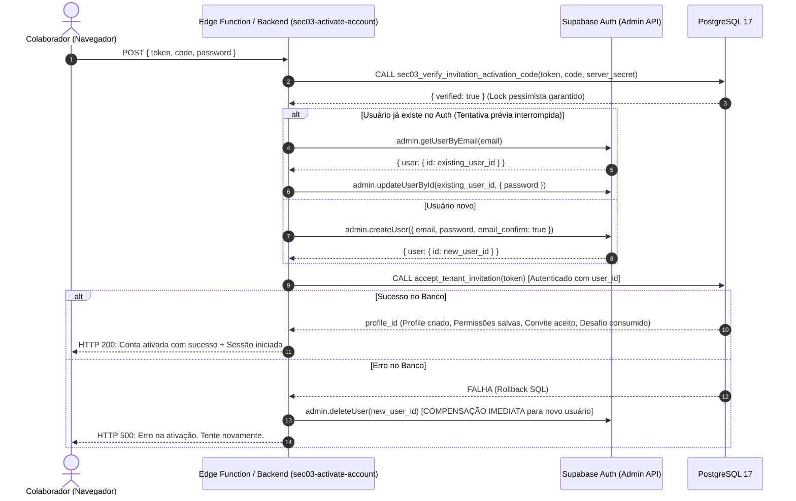

# ORBE — SEC-03 | PLANO TÉCNICO FASE 02.2: CONVITE MANUAL SIMPLIFICADO

**Data:** 30/10/2026  
**Status da Fase 02.1.1:** HOMOLOGADA EM AMBIENTE ISOLADO (20/20 PASS)  
**Objetivo da Fase 02.2:** Implementação do fluxo visual e de ativação seguro, 100% manual, sem dependências de WhatsApp, e-mail ou serviços externos.  

---

## 1. ESCOPO DEFINITIVO E DECISÃO ARQUITETURAL

Conforme alinhamento estratégico, o ERP ORBE **não dependerá de nenhum canal ou serviço externo de comunicação** (sem APIs de WhatsApp, sem `wa.me`, sem serviços de e-mail e sem automações de disparo).

### O Fluxo Operacional:
```text
[Administrador no ORBE]
      │
      ├─ Cadastra Colaborador (Nome, E-mail, Telefone, Perfil, Permissões)
      ├─ Sistema gera Link Único + Código de 6 dígitos (válido por 10 min)
      └─ Clica em "Copiar convite" (copia mensagem pronta para a Área de Transferência)
            │
            ▼ (Envio manual fora do sistema via WhatsApp, Teams, e-mail corporativo, etc.)
[Colaborador Convidado]
      │
      ├─ Abre o Link (/cadastro?token=...)
      ├─ Sistema exibe Nome e Razão Social Oficial da Empresa
      ├─ Digita o Código de Ativação de 6 dígitos
      ├─ Cria Senha Forte (mínimo 12 caracteres)
      └─ Conta Ativada com Sucesso e redirecionamento para o ERP
```

---

## 2. COMPONENTES FRONTEND A IMPLEMENTAR NA FASE 02.2

### 2.1. Modal de Criação de Convite (`InviteUserModal.tsx`)
* **Localização:** Integrado em `src/pages/Governanca/Usuarios.tsx` (ou componente modal dedicado).
* **Campos de Entrada:**
  * Nome completo (obrigatório)
  * E-mail corporativo (obrigatório)
  * Telefone / Contato (opcional, para identificação)
  * Perfil / Função (`admin`, `rh`, `financeiro`, `encarregado`, `user`)
  * Permissões granulares multi-tenant (checkboxes operacionais)
  * Validade do convite (padrão: 7 dias)
* **Chamada Backend:** Invoca `admin_create_invitation_with_activation_code`.
* **Transição de Tela:** Ao submeter com sucesso, o modal transiciona para a visualização do **Convite Gerado**.

### 2.2. Visualização do Convite Gerado & Botão Principal "Copiar Convite"
* **Exibição Visual:**
  * Header com feedback de sucesso: *"Convite criado com sucesso!"*.
  * **Código de Ativação:** Exibido em destaque (badge visual grande, monoespaçado, ex.: `867 327`).
  * **Link de Ativação:** Exibido em campo somente leitura.
  * **Contador Regressivo de Validade:** Indicador de tempo restante (10 minutos).
  * Alerta de segurança: *"Este código é individual e expira em 10 minutos. Envie-o imediatamente ao colaborador."*.
* **Ação Principal:**
  * **Botão `"Copiar convite"` (Destaque Primário com Ícone de Cópia):** Copia para o clipboard a mensagem pronta formatada:
    ```text
    Olá, [Nome]! Você foi convidado para acessar o ERP ORBE da empresa [Razão Social].

    Para ativar seu acesso:
    1. Acesse o link: https://orbe.log.br/cadastro?token=[token]
    2. Informe o código de ativação: [código]
    3. Defina sua senha de acesso.

    (Este código é individual e expira em 10 minutos).
    ```
  * Toast de feedback: *"Mensagem do convite copiada com sucesso!"*.
* **Ações Secundárias:**
  * `"Copiar apenas código"` (copia os 6 dígitos).
  * `"Copiar apenas link"` (copia a URL).
  * `"Concluir"` (fecha o modal).

### 2.3. Gestão de Convites Pendentes na Lista de Usuários (`Usuarios.tsx`)
* Na tabela de convites pendentes:
  * Exibe status do convite: `Pendente` / `Expirado`.
  * **Ação `"Gerar novo código"`:** Caso o código anterior expire antes do colaborador ativar, o Administrador clica nesta ação. A RPC `admin_issue_new_activation_code` é invocada, invalidando o anterior, aplicando o cooldown de 60s e abrindo o modal com o novo código e a mensagem pronta para cópia.
  * **Ação `"Revogar convite"`:** Invoca `admin_delete_tenant_invitation`, invalidando o token e apagando desafios em cascata.

### 2.4. Tela de Ativação do Convidado (`Cadastro.tsx`)
A tela de onboarding assistido será reestruturada em **3 etapas progressivas**:

1. **Etapa 1: Leitura e Confirmação de Identidade**
   * Ao carregar a URL `/cadastro?token=...`, invoca `validate_invitation_token(token)`.
   * Exibe card seguro:
     * Razão Social da Empresa: `tenant_name` (não mais o placeholder "Empresa").
     * Nome do Colaborador: `full_name`.
     * E-mail cadastrado: `email`.
2. **Etapa 2: Validação da Credencial de Ativação**
   * Input de código numérico de 6 dígitos (formato OTP com máscara `000000`).
   * Botão `"Verificar código"`.
   * Feedback claro de erros:
     * Código incorreto: *"Código incorreto. Você possui mais X tentativa(s)."*.
     * 5 erros: *"Limite de tentativas excedido. Solicite um novo código ao administrador."*.
     * Expirado (> 10 min): *"Código de ativação expirado. Solicite um novo código ao administrador."*.
3. **Etapa 3: Definição de Senha Forte & Ativação**
   * Campos: *"Nova Senha"* e *"Confirmar Senha"*.
   * **Validação de Complexidade:** Mínimo de 12 caracteres, com medidor de força (maiúsculas, minúsculas, números e caracteres especiais).
   * Botão `"Ativar Conta"`.
   * Provisionamento idempotente no Supabase Auth + RPC `accept_tenant_invitation` (já blindada no PostgreSQL).
   * Redirecionamento automático autenticado para o Dashboard do ERP.

---

## 3. ARQUITETURA DE PROVISIONAMENTO IDEMPOTENTE (SEM PRESUNÇÃO DE ATOMICIDADE)

A criação da conta no Supabase Auth e o vínculo relacional no PostgreSQL operam com tolerância a falhas distribuídas:



---

## 4. ROTEIRO DE IMPLEMENTAÇÃO E HOMOLOGAÇÃO DA FASE 02.2

| Etapa | Descrição | Arquivos Envolvidos |
|:---:|---|---|
| **01** | **Interface Administrativa (Modal & Copiar Convite)** | `src/pages/Governanca/Usuarios.tsx`, `src/components/modals/InviteUserModal.tsx` |
| **02** | **Ação de Reemissão na Lista de Usuários** | `src/pages/Governanca/Usuarios.tsx` (Botão "Gerar novo código") |
| **03** | **Tela de Ativação em 3 Passos** | `src/pages/Auth/Cadastro.tsx` (validação de token, input de OTP, senha $\ge 12$ chars) |
| **04** | **Edge Function / RPC de Ativação Segura** | `supabase/functions/sec03-activate-account/index.ts` |
| **05** | **Testes E2E Locais no Navegador** | Criação de convite, cópia de mensagem, ativação com código e senha forte, bloqueio após 5 falhas |

---

## 5. RECOMENDAÇÃO TÉCNICA E PRÓXIMOS PASSOS

* O backend local (PostgreSQL 17) já está **100% preparado, endurecido e testado (20/20 PASS)**, com remoção dos campos específicos de WhatsApp e suporte nativo ao campo `invitation_message`.
* A implementação do frontend no ORBE será limpa, desacoplada e focada na experiência do Administrador com o botão **"Copiar convite"**.
* **Aguardando sua autorização expressa para iniciar a implementação da FASE 02.2.**

