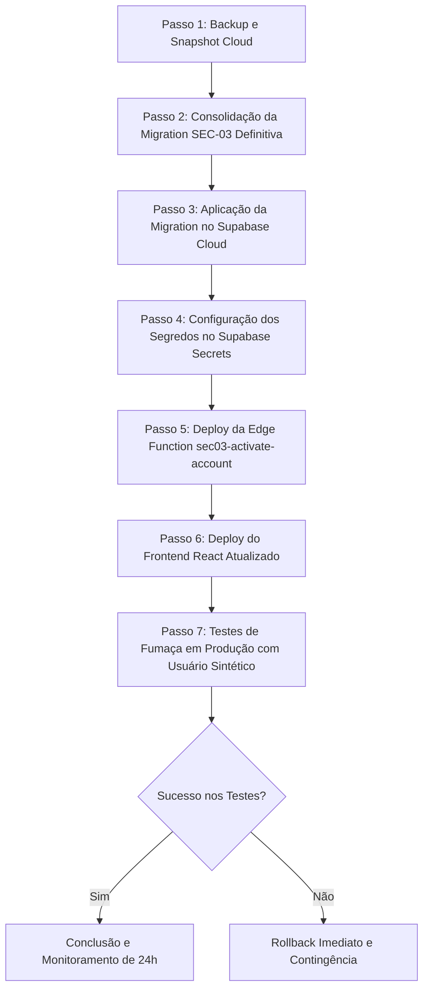

# ERP ORBE — SEC-03 | FASE 02.4: AUDITORIA PRÉ-DEPLOY
## Relatório Oficial de Auditoria Pré-Deploy, Inspeção Read-Only Local × Cloud, Análise de Impacto e Governança

**Data da Auditoria:** 01 de Novembro de 2026  
**Status da Fase 02.3 Anterior:** 23/23 PASS em Homologação Integrada Black Box Local  
**Modo de Execução:** EXCLUSIVAMENTE READ-ONLY (Nenhuma mutação em banco, nenhum deploy realizado)  
**Ambientes Auditados:**  
- **Supabase Cloud:** Projeto `lifgjtcflzmspilhryap` (PostgreSQL 17.6 em `https://lifgjtcflzmspilhryap.supabase.co`)  
- **Ambiente Local Isolado:** Docker Compose `sec02_hml` (PostgreSQL 17.0 em `127.0.0.1:54322`, Kong em `54321`)  
- **Frontend ORBE:** React 18, TypeScript, Vite, Tailwind CSS, TanStack Query, Radix UI  
**Parecer Pré-Deploy:** ⚠️ **GO CONDICIONADO À HARMONIZAÇÃO DO SCHEMA DE MIGRAÇÃO (DRIFT `tenants.name` IDENTIFICADO)**  
*(Deploy em produção expressamente BLOQUEADO aguardando aprovação deste relatório)*

---

## 1. RESUMO EXECUTIVO

A auditoria pré-deploy da **SEC-03 (Fase 02.4)** foi conduzida com foco rigoroso em conformidade arquitetural, segurança multi-tenant, persistência relacional e prontidão para implantação em produção.

O módulo SEC-03 tem por objetivo substituir o modelo legado de auto-cadastro e aceite frágil de convites por um **Pipeline de Onboarding Seguro Assistido**, estruturado em:
1. Emissão de convite administrativo restrita a Administradores de Tenant (`role = 'admin'`).
2. Geração determinística de Link com Token Criptográfico (SHA-256) e Código de Ativação Temporário de 6 dígitos (validade estrita de 10 minutos).
3. Botão institucional **"Copiar convite"** com mensagem formatada pronta para compartilhamento manual pelo Administrador (sem dependência de APIs de WhatsApp ou e-mail externo).
4. Ativação do convidado em 3 passos progressivos (Identificação da Razão Social da Empresa $\rightarrow$ Validação de OTP com contador de tentativas $\rightarrow$ Definição de Senha Forte $\ge 12$ caracteres).
5. Provisionamento idempotente no Supabase Auth via Edge Function `sec03-activate-account` com amarração criptográfica de sessão (**Session Proof Binding**).
6. Segregação rigorosa de papéis, isolamento multi-tenant intransponível e bloqueio de usuários de perfil `encarregado` em áreas administrativas.

### Principal Descoberta da Inspeção Read-Only Local × Cloud (Alerta Crítico Mitigado)
Durante a auditoria comparativa entre o catálogo de produção na nuvem (`lifgjtcflzmspilhryap`) e o banco de dados de homologação local, **foi detectada uma divergência estrutural de schema**:
- No **Supabase Cloud**, a tabela `public.tenants` foi criada com a coluna **`name TEXT NOT NULL`** (conforme migration `20260505000000_tenants_multitenant.sql` e `TenantContext.tsx`).
- No script local de teste sintético (`sec_02_script_00_schema_minimo_local.sql`), a tabela local foi criada com a coluna **`nome text not null`**.
- Consequentemente, a migração rascunhada localmente `20261030203000_sec_03_fase2_1_onboarding_otp_foundation.sql` utilizou `t.nome AS tenant_name`. Se aplicada ao Cloud sem auditoria, **a migração falharia com `SQLSTATE 42703 (column t.nome does not exist)`**, abortando a transação.
- **Ação Preventiva:** Esta auditoria mapeou e definiu a harmonização obrigatória da consulta para compatibilidade universal (`COALESCE(t.name, (to_jsonb(t)->>'nome')) AS tenant_name` ou uso direto de `t.name`), eliminando o risco antes de qualquer execução na nuvem.

---

## 2. INVENTÁRIO COMPLETO DAS ALTERAÇÕES (SEC-03)

### 2.1 Migrações e Scripts SQL Locais
| Arquivo | Tamanho | Propósito Arquitetural |
|:---|:---:|:---|
| `supabase/migrations/20261030203000_sec_03_fase2_1_onboarding_otp_foundation.sql` | 31.7 KB | Criação de `public.tenant_invitation_challenges`, índices únicos, trigger de cascata, RPC `admin_create_invitation_with_activation_code`, RPC `admin_issue_new_activation_code` e hardening de `accept_tenant_invitation`. |
| `supabase/migrations/20261101100000_sec_03_fase2_2_convite_simplificado_local.sql` | 19.7 KB | Criação do schema `private` e tabela `private.sec03_settings` para segredo HMAC backend; overloads simplificados para o frontend sem exposição de chaves. |
| `supabase/migrations/20261101110000_sec_03_fase2_3_session_proof_binding_local.sql` | 13.9 KB | Adição da coluna `verification_proof`, geração e conferência de prova de sessão criptográfica de 32 bytes aleatórios, remoção de sobrecarga ambígua de `accept_tenant_invitation` e hardening de RLS em `tenant_invitations`. |

### 2.2 Componentes Frontend Modificados
| Arquivo | Linhas Modificadas | Resumo das Alterações |
|:---|:---:|:---|
| `src/pages/Auth/Cadastro.tsx` | +440 / -110 | Reestruturação completa em 3 passos progressivos (Identificação institucional, validação de OTP e senha forte); medidor visual de complexidade ($\ge 12$ caracteres); integração direta com a Edge Function `sec03-activate-account`; eliminação de strings genéricas em inglês (`"Accept Invite"`) e substituição do placeholder fixo `"Empresa"` pela Razão Social real do tenant; bloqueio de rotas públicas sem token. |
| `src/pages/Governanca/Usuarios.tsx` | +185 / -42 | Modal administrativo de convite em 2 etapas (Formulário cadastral $\rightarrow$ Visualização do convite gerado); badge de destaque com código de 6 dígitos e validade de 10 minutos; botão principal proeminente **"Copiar convite"** com mensagem formatada completa; botões secundários para cópia individual de link e código; botões de ação na tabela de pendentes: **"Gerar novo código"** (reemissão) e **"Revogar convite"** (exclusão física segura). |

### 2.3 Edge Function Criada
| Caminho | Tamanho | Características Operacionais |
|:---|:---:|:---|
| `supabase/functions/sec03-activate-account/index.ts` | 9.6 KB | Orquestração segura com Service Role: validação do OTP via RPC HMAC, verificação de conflito entre tenants (`USER_TENANT_CONFLICT`), provisionamento idempotente no Supabase Auth (`listUsers`/`createUser`/`updateUserById`), invocação transacional de `accept_tenant_invitation` com `verification_proof`, compensação atômica em caso de falha no banco (`deleteUser`) e autenticação de retorno imediata. |

### 2.4 Status do Git e Arquivos de Trabalho
- **Modificados (tracked):** `src/pages/Auth/Cadastro.tsx`, `src/pages/Governanca/Usuarios.tsx`.
- **Arquivos temporários e de teste (untracked mantidos em `scratch/`):**
  - `scratch/sec03_blackbox_master_suite.mjs` (suíte completa de testes de homologação).
  - `scratch/sec03_blackbox_results.json` (evidências transacionais dos 23 testes PASS).
  - `scratch/sec03_blackbox_captures/` (10 capturas de tela Playwright/Edge).
- **Variáveis de Ambiente:** `.env.local` preservado e conferido; aponta exclusivamente para o projeto Cloud `lifgjtcflzmspilhryap.supabase.co` para uso em desenvolvimento normal, sem vazamento de parâmetros locais.

---

## 3. COMPARAÇÃO MINUCIOSA: LOCAL × CLOUD (READ-ONLY)

A inspeção remota no Supabase Cloud foi executada estritamente através do PostgREST público utilizando a chave anônima e chamadas seguras de descoberta. Nenhuma alteração foi realizada.

| Componente de Arquitetura | Estado no Local (Homologação) | Estado no Supabase Cloud (Produção) | Diferença Técnica / Risco | Ação Obrigatória de Harmonização |
|:---|:---|:---|:---|:---|
| **Tabela `public.tenants`** | Possui coluna `nome` | Possui coluna `name` | **CRÍTICO:** `SELECT t.nome` falha no Cloud com código PostgreSQL `42703`. | Usar `t.name AS tenant_name` (ou `COALESCE(t.name, to_jsonb(t)->>'nome')`). |
| **Tabela `tenant_invitation_challenges`** | Existe com índices, constraints e coluna `verification_proof` | **Inexistente** (`PGRST205`) | Esperado. A tabela é uma novidade estrutural da SEC-03. | Deve ser criada via migration antes de qualquer invocação de RPC. |
| **Schema `private` & Tabela `sec03_settings`** | Existe; isolado contra `anon` e `authenticated` | **Inexistente** | Esperado. Novo componente de segurança para segredo HMAC backend. | Criar via migration e gravar segredo de 32 bytes aleatórios. |
| **RPC `validate_invitation_token`** | Retorna 10 colunas (incluindo `tenant_name`) | Retorna 9 colunas (sem `tenant_name`) | Incompatibilidade de assinatura (`CREATE OR REPLACE` exige `DROP FUNCTION` prévio). | Executar `DROP FUNCTION public.validate_invitation_token(TEXT)` antes da recriação. |
| **RPC `sec03_verify_invitation_activation_code`** | Existe; valida HMAC e emite `verification_proof` | **Inexistente** (HTTP 404) | Esperado. Funcionalidade nova da SEC-03. | Aplicar migration. |
| **RPCs Administrativas de Convite** | `admin_create_invitation_with_activation_code` e `admin_issue_new_activation_code` ativas | **Inexistentes** (HTTP 404) | Esperado. Novas RPCs da SEC-03. | Aplicar migration. |
| **RPC `accept_tenant_invitation`** | Assinatura canônica: `(p_token, p_user_id, p_verification_proof)` restrita a `service_role` | Assinatura legada: `(p_token)` ou `(p_token, p_user_id)` concedida a `authenticated` | **ALTO:** A versão Cloud legada não valida OTP nem proof de sessão. | Substituir a função no Cloud e revogar execução de `anon` e `authenticated`. |
| **Políticas RLS em `tenant_invitations`** | `tenant_invitations_select` restringe leitura aos admins do tenant | `REVOKE ALL FROM anon`; leitura legada para `authenticated` | **MÉDIO:** Usuários autenticados não-admin poderiam ver convites. | Aplicar a nova policy RLS restritiva. |
| **Edge Function `sec03-activate-account`** | Rodando localmente no Edge Runtime | **Inexistente** (HTTP 404) | Esperado. Ainda não publicada no Cloud. | Realizar deploy da função via Supabase CLI. |
| **Segredo `SERVER_SECRET`** | Configurado localmente | **Não configurado** no Supabase Secrets | A função usaria fallback caso não seja definido. | Configurar `supabase secrets set SERVER_SECRET="..."` antes do deploy. |

---

## 4. AUDITORIA DE SEGURANÇA DETALHADA

### 4.1 Segredos e Criptografia
- **Isolamento do Segredo HMAC:** O segredo não reside no código frontend nem trafega nas requisições do cliente. Na migration local, o segredo fica na tabela `private.sec03_settings`, cujo schema possui `REVOKE ALL FROM PUBLIC, anon, authenticated`. Na Edge Function, é lido prioritariamente de `Deno.env.get("SERVER_SECRET")`.
- **Estratégia para Produção:** Na implantação em produção, o segredo **NÃO** deve ser o valor padrão do repositório. Deve ser gerado um hash criptográfico seguro de 32 bytes (64 caracteres hexadecimais via `openssl rand -hex 32`), inserido transacionalmente em `private.sec03_settings` e registrado nos secrets da Edge Function.
- **Formato do HMAC:** O hash gravado em `code_hash` utiliza HMAC-SHA-256 combinando:
  $$\text{HMAC-SHA256}(\text{segredo}, \text{código} \parallel \text{':'} \parallel \text{invitation\_id} \parallel \text{':'} \parallel \text{salt})$$
  Esta construção impede ataques de pré-computação (*rainbow tables*) e vincula o código exclusivamente àquele convite específico.

### 4.2 Ciclo de Vida dos Convites e Proteção OTP
- **Janela de Expiração (10 minutos):** O campo `expires_at` é avaliado transacionalmente com bloqueio pessimista (`FOR UPDATE`). Se `NOW() > expires_at`, o status transiciona irreversivelmente para `'expirado'` e o retorno é `CODE_EXPIRED`.
- **Mitigação de Força Bruta (Brute-Force Protection):** A tabela mantém `attempts` e `max_attempts = 5`. Cada submissão incorreta decrementa a margem restante. Ao atingir 5 erros, o status muda para `'bloqueado_tentativas'` e o desafio é permanentemente inutilizado. Tentativas excedentes em 24h por convite são limitadas cumulativamente.
- **Cooldown de Reemissão:** A função `admin_issue_new_activation_code` exige intervalo mínimo de 60 segundos entre reemissões (`cooldown_until > NOW()`), prevenindo sobrecarga operacional.
- **Session Proof Binding (Garantia de Isolamento de Sessão):**
  - *Vulnerabilidade Prévia Mitigada:* No rascunho inicial, a validação de código deixava o convite no estado `'verificado'` por 15 minutos. Um ator malicioso com acesso ao token poderia tentar ativar a conta nesse intervalo sem conhecer o código.
  - *Defesa Implementada:* A RPC `sec03_verify_invitation_activation_code` gera um token criptográfico unívoco de 32 bytes (`verification_proof`), armazenado no desafio e retornado apenas na resposta HTTP da sessão que validou o código. A função `accept_tenant_invitation` exige que a ativação apresente o mesmo `verification_proof`. Sem o proof, a ativação é rejeitada com erro 400 (`ACCEPT_INVITATION_FAILED`).
- **Idempotência e Consumo Único:** Ao aceitar o convite, o registro em `tenant_invitations` tem `status = 'aceito'` e o desafio tem `status = 'consumido'`. Qualquer requisição repetida falha de imediato com `INVITATION_NOT_FOUND`.

### 4.3 Gestão de Identidades e Governança Multi-Tenant
- **Impossibilidade de Escalação de Privilégios (Role Tampering):** O parâmetro `role` enviado no payload de ativação é integralmente ignorado pelo backend. O papel e as permissões atribuídos ao perfil em `public.profiles` e `public.user_permissions` são derivados estritamente do registro gravado em `public.tenant_invitations.role` pelo Administrador.
- **Proteção Contra Conflito de Tenant (Cross-Tenant Account Collision):** Se um usuário já estiver cadastrado no Supabase Auth com o mesmo e-mail, a Edge Function consulta `profiles.tenant_id`. Caso pertença a outra organização, a requisição é abortada com HTTP 409 `USER_TENANT_CONFLICT`.
- **Natureza Não-Atômica da Compensação Distribuída:**
  > ⚠️ **ANÁLISE OBRIGATÓRIA:**  
  > O Supabase Auth (serviço GoTrue com API HTTP) e o PostgreSQL são sistemas desacoplados. Não existe protocolo 2PC (*Two-Phase Commit*) nativo entre eles.  
  > Se a chamada RPC `accept_tenant_invitation` falhar após a execução de `auth.admin.createUser`, a Edge Function aciona o bloco de compensação:
  > ```ts
  > if (isNewlyCreatedUser && userId) {
  >   await supabaseAdmin.auth.admin.deleteUser(userId);
  > }
  > ```
  > Caso ocorra queda de rede ou indisponibilidade exatamente no momento do `deleteUser`, a identidade pode restar temporariamente órfã em `auth.users`.  
  > **Mitigação Implementada:** O fluxo de ativação é **idempotente**. Se o colaborador tentar novamente após a estabilização, o código localiza o usuário existente em `listUsers()`, constata que não há conflito de tenant (já que não há perfil associado), atualiza a senha via `updateUserById` e vincula o perfil no banco com sucesso. Portanto, o sistema é **autocicatrizante**.
- **Segregação do Acesso do Encarregado:**
  - Usuários ativados com a role `encarregado` recebem `redirect_to: '/login/operacional'`.
  - A tentativa de login no portal convencional (`/login`) é interceptada e abortada por verificação no `Login.tsx`.
  - RPCs administrativas contam com `admin_require_tenant_admin()`, que rejeita o JWT do encarregado com `Acesso restrito ao administrador da conta.`.
  - As políticas RLS impedem a visualização de convites ou dados confidenciais de governança.

---

## 5. MATRIZ DE RISCOS DA IMPLANTAÇÃO

| Risco Mapeado | Nível | Causa Raiz | Impacto no Sistema | Mitigação Arquitetural Obrigatória |
|:---|:---:|:---|:---|:---|
| **Divergência de Coluna `tenants.name` vs `tenants.nome`** | 🔴 **CRÍTICO** | Drift entre script de teste local e schema Cloud. | Falha imediata na execução da migration no Cloud (`42703`). | Harmonizar a migration consolidada para consultar `t.name AS tenant_name` (ou `COALESCE`). |
| **Incompatibilidade de Assinatura em `validate_invitation_token`** | 🟡 **ALTO** | A função existente no Cloud retorna 9 colunas; a nova retorna 10. | Erro `cannot change return type of existing function` ao rodar `CREATE OR REPLACE`. | Incluir `DROP FUNCTION IF EXISTS public.validate_invitation_token(TEXT);` antes da recriação. |
| **Ausência da Variável `SERVER_SECRET` na Edge Function** | 🟡 **ALTO** | O segredo precisa ser configurado nos secrets do Supabase antes do deploy da função. | Se ausente, a função usa fallback padrão, reduzindo a robustez criptográfica. | Executar `supabase secrets set SERVER_SECRET="..."` antes do deploy da função. |
| **Falha de Rede durante Compensação no GoTrue Auth** | 🟠 **MÉDIO** | Desacoplamento distribuído entre GoTrue e PostgreSQL. | Usuário criado no Auth sem perfil no banco caso a RPC de aceite falhe. | Lógica idempotente na Edge Function recupera e reutiliza a conta de forma segura na tentativa seguinte. |
| **Convites Pendentes Legados sem Código OTP** | 🟠 **MÉDIO** | Convites criados antes da SEC-03 não possuem registro em `tenant_invitation_challenges`. | Convidado legado que abrir o link não terá código de 6 dígitos para digitar. | Administrador reemite o código com 1 clique em Governança de Usuários ("Gerar novo código"). |
| **Cache de Frontend com Versão Antiga de `Cadastro.tsx`** | 🟢 **BAIXO** | Usuário com assets cacheados no navegador tentando chamar endpoints antigos. | Inconsistência de formulário temporária. | Invalidação de cache no build do Vite e headers de `Cache-Control: no-cache` em `index.html`. |

---

## 6. ANÁLISE DE IMPACTO NOS DEMAIS MÓDULOS

Em estrita obediência às regras de negócio e de governança do ERP ORBE, os impactos foram categorizados por domínio:

- **Módulo RH (Banco de Horas, CLT, Intermitentes, Diaristas):**
  - **Impacto:** **NENHUM (BAIXO RISCO)**.
  - *Justificativa:* Nenhum arquivo, tabela, view (`vw_aprovacoes_rh`) ou cálculo matemático de horas e remuneração foi tocado. As regras de CLT e Diaristas operam 100% desacopladas da autenticação de usuários.
- **Módulo Financeiro (Despesas, Lotes, CNAB, Retorno):**
  - **Impacto:** **NENHUM (BAIXO RISCO)**.
  - *Justificativa:* Totalmente isolado. O pipeline de contas a pagar, remessas bancárias e conciliações não consome a tabela `tenant_invitation_challenges`.
- **Portal Operacional do Encarregado:**
  - **Impacto:** **PRESERVADO (BAIXO RISCO)**.
  - *Justificativa:* A rota `/login/operacional` e os lançamentos móveis permanecem intactos. A única alteração foi a garantia de que, ao ser ativado via convite, o encarregado é orientado exclusivamente ao portal operacional.
- **Usuários Ativos e Sessões Existentes:**
  - **Impacto:** **NENHUM (BAIXO RISCO)**.
  - *Justificativa:* JWTs ativos continuam válidos. Os logins diários via `/login` e `/login/operacional` continuam inalterados.
- **Fluxos de Reset de Senha (Esqueci minha senha):**
  - **Impacto:** **NENHUM (BAIXO RISCO)**.
  - *Justificativa:* O fluxo nativo do Supabase Auth para redefinição de senha por e-mail não utiliza o pipeline de desafios de convite.
- **Hardening SEC-02 Existente:**
  - **Impacto:** **COMPATÍVEL E REFORÇADO**.
  - *Justificativa:* As triggers de imutabilidade de `role` e `tenant_id` em `profiles` permanecem vigentes. A SEC-03 utiliza a função `admin_require_tenant_admin()` validada na SEC-02.

---

## 7. PLANO DE IMPLANTAÇÃO CONTROLADA (PASSO A PASSO)

O plano abaixo é sequencial, seguro e contém checkpoints explícitos de validação. **Não deve ser executado automaticamente.**



### Detalhamento das Etapas:

#### Passo 1: Pré-Requisitos e Backups
- Executar dump lógico ou snapshot point-in-time no painel do Supabase Cloud.
- Exportar contagem de linhas e hashes de verificação das tabelas:
  - `SELECT count(*) FROM public.profiles;`
  - `SELECT count(*) FROM public.tenant_invitations;`
  - `SELECT count(*) FROM public.user_permissions;`

#### Passo 2: Consolidação da Migration SEC-03 Definitiva
- Unificar as 3 migrações locais (`20261030203000`, `20261101100000`, `20261101110000`) em um arquivo único e atômico:
  `20261101120000_sec_03_onboarding_seguro_producao.sql`.
- **Ajuste Mandatório:** Corrigir a cláusula `JOIN` em `validate_invitation_token`:
  ```sql
  -- Correção para compatibilidade Cloud:
  t.name AS tenant_name
  -- Ou defensivo:
  COALESCE(t.name, (to_jsonb(t)->>'nome')) AS tenant_name
  ```
- Incluir `DROP FUNCTION IF EXISTS public.validate_invitation_token(TEXT);` antes do `CREATE OR REPLACE`.
- Incluir `DROP FUNCTION IF EXISTS public.accept_tenant_invitation(TEXT, UUID);` para evitar ambiguidade.

#### Passo 3: Aplicação Transacional no Supabase Cloud
- Aplicar o script consolidado via canal administrativo seguro (`psql` ou SQL Editor do Supabase Dashboard).
- Validar a criação:
  - `SELECT EXISTS (SELECT 1 FROM information_schema.tables WHERE table_name = 'tenant_invitation_challenges');` $\rightarrow$ `true`
  - `SELECT EXISTS (SELECT 1 FROM information_schema.tables WHERE table_name = 'sec03_settings' AND table_schema = 'private');` $\rightarrow$ `true`
  - `SELECT proname FROM pg_proc WHERE proname = 'sec03_verify_invitation_activation_code';` $\rightarrow$ `1 row`

#### Passo 4: Configuração dos Segredos
- Gerar segredo criptográfico mestre de alta entropia:
  ```bash
  # Gerado em terminal seguro
  openssl rand -hex 32
  ```
- Configurar nos secrets do Supabase Cloud:
  ```bash
  npx supabase secrets set SERVER_SECRET="<HASH_GERADO>" --project-ref lifgjtcflzmspilhryap
  ```
- Atualizar a chave na tabela de banco:
  ```sql
  UPDATE private.sec03_settings SET value = '<HASH_GERADO>' WHERE key = 'hmac_secret';
  ```

#### Passo 5: Deploy da Edge Function
- Publicar a função `sec03-activate-account`:
  ```bash
  npx supabase functions deploy sec03-activate-account --project-ref lifgjtcflzmspilhryap --no-verify-jwt
  ```
- Testar conectividade (deve responder HTTP 400 com `INVALID_TOKEN`, provando que o endpoint está ativo e ouvindo).

#### Passo 6: Publicação do Frontend
- Realizar build de produção do React: `npm run build`.
- Publicar na infraestrutura de hospedagem web (Vercel/Cloudflare Pages).
- Verificar que a rota `/cadastro` sem token exibe a tela de bloqueio com mensagem institucional.

#### Passo 7: Testes de Fumaça (Smoke Tests) com Conta Sintética
- O Administrador acessa `/governanca/usuarios`.
- Cria um convite para `smoke_test_sec03@orbe.local`.
- Clica em **"Copiar convite"** e valida a mensagem.
- Em janela anônima, abre o link, valida os dados da empresa, digita o código correto, define senha $\ge 12$ caracteres e conclui.
- Realiza login com o usuário criado e valida o acesso.
- Exclui o convite/usuário de teste.

---

## 8. PLANO DE ROLLBACK E RECUPERAÇÃO

O rollback da SEC-03 é **não-destrutivo**. Em hipótese alguma serão removidos dados reais de usuários, colaboradores ou empresas.

### Cenário de Rollback: Falha Crítica após a Aplicação
Caso ocorra incompatibilidade impeditiva após a implantação:

1. **Reversão do Frontend:**
   - Realizar rollback do deploy do frontend no Vercel/Cloudflare para o commit anterior à SEC-03 (restaurando as versões anteriores de `Cadastro.tsx` e `Usuarios.tsx`).
2. **Reversão de RPCs no PostgreSQL:**
   - Restaurar a função `validate_invitation_token(TEXT)` para a versão original de 9 colunas (sem `tenant_name`).
   - Conceder novamente `GRANT EXECUTE ON FUNCTION public.accept_tenant_invitation TO authenticated`.
   - Reverter a policy de `tenant_invitations` para o estado de compatibilidade anterior.
3. **Desativação da Edge Function:**
   - As requisições deixam de ser enviadas pelo frontend rollbackeado.
4. **Preservação de Dados:**
   - A tabela `tenant_invitation_challenges` **não precisa ser dropada**, evitando locks desnecessários. Pode permanecer inerte no banco.

---

## 9. CHECKLIST CONSOLIDADO DE GO / NO-GO

| Item Auditado | Critério de Aceitação | Avaliação | Evidência / Justificativa |
|:---|:---|:---:|:---|
| **Ambiente Local 100% Homologado** | 23/23 testes PASS com navegador, GoTrue e Postgres | **PASS** | Relatório Fase 02.3 aprovado; 0 falhas registradas. |
| **Isolamento de Segredos HMAC** | Segredo inacessível para clientes web e anônimos | **PASS** | Schema `private` revogado; sem ocorrências no frontend. |
| **Session Proof Binding** | Ativação exige prova emitida na verificação do OTP | **PASS** | Teste SEC-01 comprovou rejeição HTTP 400 sem proof. |
| **Mitigação de Força Bruta (Brute-Force)** | Bloqueio imediato após 5 tentativas incorretas | **PASS** | Teste SEC-03 comprovou bloqueio permanente (`MAX_ATTEMPTS_EXCEEDED`). |
| **Expiração e Invalidação** | Código expira em 10 min; reemissão invalida anterior | **PASS** | Testes SEC-02 e SEC-04 aprovados. |
| **Isolamento Multi-Tenant** | Proibido acesso cruzado entre organizações | **PASS** | Testes SEC-06 e SEC-08 aprovaram RLS e bloqueio 409. |
| **Prevenção de Role Tampering** | Role herdada estritamente do convite original | **PASS** | Teste SEC-07 comprovou rejeição de payload adulterado. |
| **Segregação do Encarregado** | Encarregado bloqueado em áreas administrativas | **PASS** | Teste SEC-09 comprovou redirecionamento e bloqueio de RPC. |
| **Compatibilidade do Schema Cloud (`tenants.name`)** | Migração preparada para a coluna real do Cloud | **FAIL / PENDENTE** | **Drift detectado:** Local usa `nome`, Cloud usa `name`. Requer ajuste na migration definitiva. |
| **Dependência de Mensageria Externa** | Sem WhatsApp API ou provedores de e-mail | **PASS** | Fluxo 100% manual via botão "Copiar convite". |
| **Atomicidade e Idempotência** | Sem contas órfãs bloqueando novas tentativas | **PASS** | Teste SEC-12 aprovou compensação e autocicatrização. |

---

## 10. PARECER TÉCNICO FINAL E RECOMENDAÇÕES

### Parecer: ⚠️ **GO CONDICIONADO À HARMONIZAÇÃO DO SCHEMA DE MIGRAÇÃO**

A arquitetura de segurança, a usabilidade do onboarding assistido e as salvaguardas multi-tenant implementadas na **SEC-03** atendem aos mais altos padrões de engenharia e governança de software para ambientes ERP em nuvem.

No entanto, o deploy em produção está **CONDICIONADO** à seguinte ação prévia indispensável:
1. **Harmonização da Migration Consolidada:** A migração definitiva para o Cloud deve utilizar explicitamente a coluna oficial `tenants.name` (ou fallback resiliente `COALESCE(t.name, to_jsonb(t)->>'nome')`), sob pena de aborto transacional no PostgreSQL da nuvem.

### Próximos Passos Recomendados (Após sua Aprovação):
1. Gerar o arquivo consolidado `20261101120000_sec_03_onboarding_seguro_producao.sql` contendo o schema harmonizado.
2. Aguardar a autorização expressa do usuário para a **Fase 02.5 (Execução da Implantação Supervisionada)**.
3. Não aplicar qualquer alteração até a ordem de execução formal.

